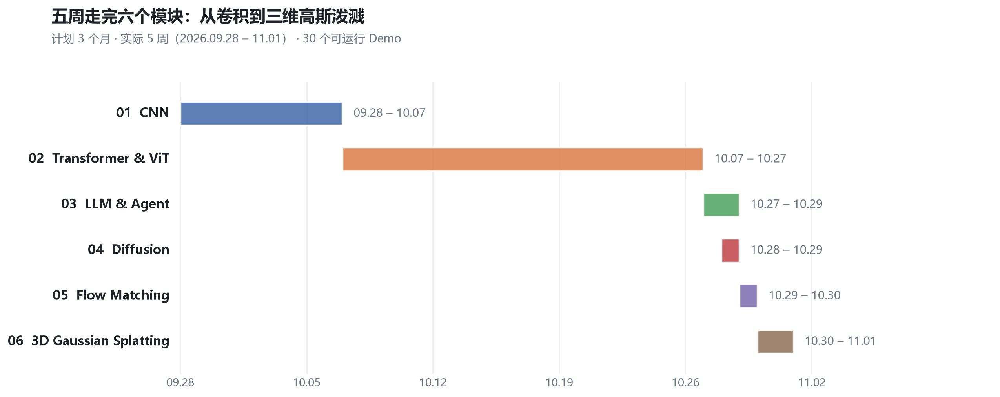
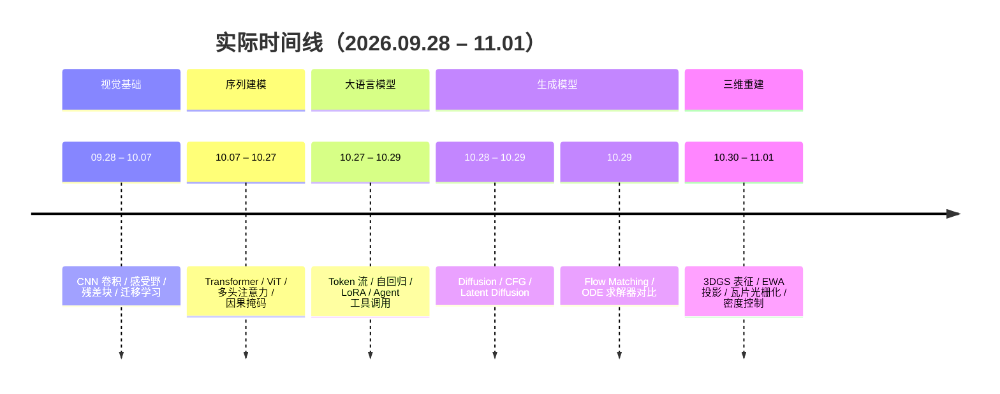

<div align="center">

# 从 CNN 到 3DGS

**一个月 AI 基础训练手册 · 6 个模块 · 30 个可运行 Demo · 8 篇中文笔记**


</div>

> 这是我研究生入学第一个月的自学记录：从卷积网络一路学到三维高斯泼溅（3DGS）。
> 每个模块都走同一个闭环 —— **读原理 → 手推张量形状 → 写最小 Demo → 记录踩坑**。
> 仓库里的 30 个 `*.py` 全部可直接运行，每篇 `docs/*.md` 都是为「半年后还能看懂」而写的复习笔记。

| 时间 | 模块 | 代码 | 笔记 | 算力 |
| :---: | :---: | :---: | :---: | :---: |
| 2026.09.28 – 11.01 | 6 个 | 30 个 Demo | 8 篇 | 本地 CPU 即可 |

---

## 📍 目录

- [这个仓库是什么](#-这个仓库是什么)
- [学习路线](#%EF%B8%8F-%E5%AD%A6%E4%B9%A0%E8%B7%AF%E7%BA%BF)
- [六个模块，六句话](#-六个模块六句话)
- [我到底搞懂了什么](#-我到底搞懂了什么)
- [仓库结构](#-仓库结构)
- [快速开始](#-快速开始)
- [我是怎么学的](#-我是怎么学的)
- [论文复现（第二阶段）](#-论文复现第二阶段)
- [下一步](#-下一步)

---

## 🎯 这个仓库是什么

导师给的入门技术清单是：**CNN · Transformer · LLM/Agent · Diffusion · Flow Matching · 3D Gaussian Splatting**，原计划三个月打底。我把每个方向都压缩成「一个能跑通的最小闭环」，用约五周时间走完了第一轮。

这个仓库不追求复现 SOTA，而是解决三个具体问题：

1. **看得见**：每个抽象概念都对应一个能打印出张量形状的脚本，形状对不上就是没学懂；
2. **改得动**：代码全部是裸 PyTorch / NumPy 手写（不调 `diffusers`、`transformers` 的高层 API），所以每一行都能改；
3. **查得到**：把当时的困惑、报错、想明白的瞬间都写进了笔记的「踩坑记录」里。

> 换句话说：这不是一份"教程"，而是一份**带可执行证据的学习档案**。

---

## 🗺️ 学习路线





> 计划是 3 个月，实际 5 周跑完第一轮。差距不在"看得快"，而在于第一轮只要求**跑通 + 讲清输入输出**，不要求推导数学闭环。

---

## 🧩 六个模块，六句话

| # | 模块 | 一句话总结 | 核心概念 | 代码 | 笔记 |
| :-: | :--- | :--- | :--- | :-: | :-: |
| 01 | **CNN** | 用「局部感受野 + 权重共享」把像素逐层抽象成语义 | 卷积核 / 通道 / 感受野 / 池化 / 残差连接 / 迁移学习 | [4 个](code/01_cnn) | [📄](docs/01-cnn.md) |
| 02 | **Transformer & ViT** | 把图像切成图块当句子读，用注意力换全局感受野 | Patch Embedding / QKV / 多头 / 位置编码 / CLS / 因果掩码 | [8 个](code/02_transformer) | [📄](docs/02-transformer.md) |
| 03 | **LLM & Agent** | 预测下一个 Token 的循环，加上工具调用就成了 Agent | Embedding / Tokenizer / 自回归 / LoRA / Function Calling | [4 个](code/03_llm_agent) | [📄](docs/03-llm-agent.md) |
| 04 | **Diffusion** | 学会擦掉自己加的噪声，就能从雪花屏里"长"出图像 | 闭式加噪 / UNet / DDPM 采样 / CFG / Latent Diffusion | [5 个](code/04_diffusion) | [📄](docs/04-diffusion.md) |
| 05 | **Flow Matching** | 把弯曲的去噪路径拉成直线，用 ODE 积分一步到位 | 直线插值 / 速度场 / Euler / Midpoint / NFE | [3 个](code/05_flow_matching) | [📄](docs/05-flow-matching.md) |
| 06 | **3D Gaussian Splatting** | 用几百万个可微椭球显式表示场景，投影拍扁即成像 | 协方差 / 四元数 / 球谐 / EWA / Alpha Blending / 密度控制 | [6 个](code/06_3dgs) | [📄](docs/06-3dgs.md) |

附带一篇工程笔记：[07 · Git 工作流](docs/07-git-workflow.md)（这个仓库本身就是它的一次实践）。

---

## 🔍 我到底搞懂了什么

每个模块挑一条"最想讲给面试官听"的收获：

### 01 CNN —— 残差连接解决的不是"梯度消失"四个字，而是"该不该保留这一层"

网络退化的本质是：堆更多层后，**恒等映射反而学不出来**。残差块把目标从「学 H(x)」改成「学残差 F(x) = H(x) − x」，于是"这层没用"只需要把 F(x) 压到 0。
副作用是：即使 w、b 归零，梯度仍能沿 shortcut 顺畅回流，1000 层才训得动。
工程细节：`F(x)` 与 `x` 通道数不一致时，shortcut 要用 1×1 卷积做**投影**，否则加法直接报维度错。

### 02 Transformer —— 多头注意力不是把计算量乘 8

`embed_dim=64`、`heads=4` 时，每个头只分到 16 维：**总参数量与计算量几乎不变**，变的只是"从 4 个不同的子空间同时观察关系"。
另一个反直觉点：Transformer 对图块顺序**完全不敏感**（置换不变性），所以位置编码不是锦上添花，而是它知道"上下左右"的唯一来源。

### 03 LLM & Agent —— 大模型不是"知道答案"，而是"知道该调用谁"

LLM 的三件套是 Embedding 查表 → 因果注意力 → LM Head 打分，自回归只是把最后一位的 argmax 拼回输入。
LoRA 把 4096×4096（约 1678 万参数）的旁路换成两个薄矩阵 `4096×8` 与 `8×4096`，可训练参数降到 **0.39%**。
Agent 的杠杆在于：模型只输出一段 JSON 说明"要调哪个函数、参数是什么"，真正的计算交给外部 Python，结果再塞回上下文。

### 04 Diffusion —— 加噪不需要循环 1000 次

DDPM 的闭式解 `x_t = √ᾱ_t · x_0 + √(1−ᾱ_t) · ε` 让"第 t 步的脏图"一步算出来，这是它能大规模训练的前提。
推理时反而必须小步慢跑：t=999 时原图信号几乎为 0，网络只能猜出粗糙轮廓，一步到位必然糊。
CFG 则是在每一步做两次预测，用 `ε_uncond + s·(ε_cond − ε_uncond)` 把"文字带来的那一点方向偏移"放大 s 倍。

### 05 Flow Matching —— 生成速度的瓶颈是 NFE，不是阶数

扩散的 SDE 轨迹像醉汉，Flow Matching 用 ODE 把路径拉直，于是 10 步 Euler 就能出图。
Midpoint 精度更高，但一步要调两次网络（NFE 翻倍）；在轨迹已经足够直的前提下，**把 Euler 步数加倍通常比换高阶求解器更划算**——这也是 SD3 / Flux 一类模型偏爱 Euler 的原因。

### 06 3DGS —— 快，是因为它根本不用神经网络做渲染

NeRF 渲染一帧要沿 200 万条光线各采上百个点、每点过一次 MLP；3DGS 把这些计算换成了**显卡原生的光栅化**：
几十万个高斯的 `Σ = R S Sᵀ Rᵀ` 经 `J W Σ Wᵀ Jᵀ` 投影成 2D 椭圆，按 Tile 分块、64 位 `[TileID | Depth]` 基数排序，再从前到后 Alpha 混合，累积不透明度饱和即 Early Stop。
训练时反向传播直接更新每个高斯的 11 个几何参数 + 48 个球谐系数——**场景本身就是模型**。

---

## 📁 仓库结构

```text
CNN-to-3DGS/
├── README.md                  # 你正在看的这一页
├── docs/                      # 8 篇可复习的笔记（含公式、形状表、踩坑、自测题）
│   ├── 00-roadmap.md          # 学习路线与方法论
│   ├── 01-cnn.md
│   ├── 02-transformer.md
│   ├── 03-llm-agent.md
│   ├── 04-diffusion.md
│   ├── 05-flow-matching.md
│   ├── 06-3dgs.md
│   └── 07-git-workflow.md
├── code/                      # 6 个模块 / 30 个 Demo，每个目录都有 README
│   ├── 01_cnn/                # 训练 / 推理 / 残差块 / 迁移学习
│   ├── 02_transformer/        # 自注意力 / 多头 / 位置编码 / ViT / 因果掩码
│   ├── 03_llm_agent/          # Token 流 / 自回归 / LoRA / Agent
│   ├── 04_diffusion/          # 加噪 / UNet / 采样 / CFG / Latent
│   ├── 05_flow_matching/      # 直线流 / Euler 采样 / 求解器对比
│   └── 06_3dgs/               # 表征 / 投影 / 可微渲染 / 球谐 / 密度控制
├── assets/figures/            # 文中插图（脚本生成，非截图）
├── tools/make_figures.py      # 一键重绘全部插图
├── paper-reproduction/        # 第二阶段：论文精读与 Baseline 复现
│   ├── templates/             # 论文卡片 / 精读笔记 / 复现日志模板
│   ├── checklists/            # 复现前中后的自检清单
│   └── papers/                # 每篇论文一个目录（YYYY-一作-简称）
└── requirements.txt
```

---

## 🚀 快速开始

```bash
# 1. 克隆
git clone git@github.com:Zhangmingxu8/CNN-to-3DGS.git
cd CNN-to-3DGS

# 2. 环境（建议 Python 3.10+；CPU 版 PyTorch 足够）
python -m venv .venv
source .venv/bin/activate        # Windows: .venv\Scripts\activate
pip install -r requirements.txt

# 3. 跑一个最简单的：看卷积怎么把 28×28 变成 7×7
python code/01_cnn/resblock_demo.py

# 4. 训练一个 Fashion-MNIST 分类器（首次运行会自动下载约 30MB 数据）
python code/01_cnn/train_cnn_demo.py
```

**推荐阅读顺序**（也适合面试前速刷）：

```text
docs/00-roadmap.md → docs/01-cnn.md → docs/02-transformer.md
→ docs/03-llm-agent.md → docs/04-diffusion.md
→ docs/05-flow-matching.md → docs/06-3dgs.md
```

> ⚠️ 小提示：`code/04_diffusion/diffusion_sampling_demo.py` 与 `code/05_flow_matching/*` 里的采样脚本使用的是**随机初始化、未训练**的网络，
> 目的是观察采样循环的数学行为（均值/方差如何变化），输出不会是一张有意义的图——这是刻意设计的，笔记里也写明了。

---

## 🧠 我是怎么学的

一个月能跑完六个方向，靠的不是"看得快"，而是四条笨办法：

| 方法 | 具体做法 | 收益 |
| :--- | :--- | :--- |
| **形状先行** | 每个模块先画一张「张量形状流转表」，写代码前先手推 `[B, C, H, W]` 怎么变 | 报错从"玄学"变成"定位到第几行" |
| **最小闭环** | 不求复现论文，只求一条能跑通的最小链路（数据→前向→loss→反向→输出） | 一天一个模块，不被环境问题卡死 |
| **注释即笔记** | 每个脚本文件头写清「解决什么痛点 / 核心公式 / 张量流动」 | 半年后打开还能秒懂 |
| **踩坑留档** | 报错原文 + 原因 + 修法，直接写进 `docs` 的「踩坑记录」 | 同一个坑不会踩第二次 |

环境上的两个关键决定：

- **Anaconda + PyCharm**：每个模块独立虚拟环境，避免 CUDA / torch 版本互相污染；
- **WSL2**：3DGS 一类的官方实现只提供 Linux 预编译包，WSL2 里能直接编译 CUDA 算子，省去在 Windows 上折腾 C++ 工具链。

---

## 📚 论文复现（第二阶段）

第一轮"广度扫盲"结束后，仓库进入第二阶段：**从跑通 Demo 转向复现论文**。
这部分内容独立放在 [`paper-reproduction/`](paper-reproduction/README.md)，与基础篇分开，方便直接看"研究能力"这一层。

```text
选文 → 精读（问题 / 方法 / 实验 / 局限） → 环境 → 跑通 → 指标对齐 → 消融
                                              ↘ 跑不通也要记录原因
```

为了让每篇论文的产出格式统一，这套工作流已经模板化：

| 模板 | 用途 |
| :--- | :--- |
| [`paper-card`](paper-reproduction/templates/paper-card.md) | 论文卡片：30 秒回忆起一篇论文做了什么 |
| [`paper-note`](paper-reproduction/templates/paper-note.md) | 精读笔记：公式人话化 + 批判性阅读 + 与组内工作的关系 |
| [`repro-log`](paper-reproduction/templates/repro-log.md) | 复现日志：环境、命令、论文 vs 我的指标对照、差异分析 |
| [`repro-checklist`](paper-reproduction/checklists/repro-checklist.md) | 复现前 / 中 / 后的自检清单（含"论文没说的超参在哪里翻"） |

> 状态：📖 第 1 篇精读中 —— [**DCx（SIGGRAPH 2026）**](paper-reproduction/papers/2026-Bao-DCx/README.md)：论文精读、术语表、代码地图已完成；环境因本机无 NVIDIA GPU 暂缓到云 GPU（详见其 `repro.md`）。

---

## 🔭 下一步

第一轮"广度扫盲"到此为止，接下来切到深度：

- [x] 搭建论文复现工作流与模板（[`paper-reproduction/`](paper-reproduction/README.md)）
- [ ] 精读组内 3–5 篇 SIGGRAPH / CVPR 论文（神经隐式场、3DGS、点云重建）
- [ ] 在云端 GPU 复现 3DGS 官方实现，跑通真实场景重建
- [ ] 读懂 CUDA 光栅化算子，尝试改进高斯初始化 / 几何约束
- [ ] 把玩具 Demo 升级成可对比实验（Ablation）

---

<div align="center">

**如果这个仓库对你有帮助，欢迎 Star ⭐**

笔记内容基于个人理解整理，如有错误欢迎提 Issue 指正。

</div>
