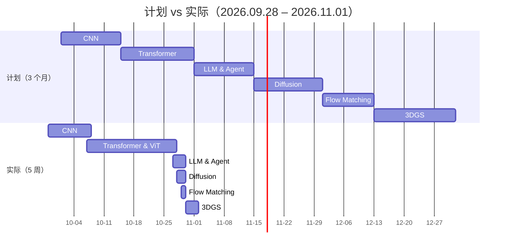

# 00 · 学习路线与方法论

> 目标：用最短时间把「视觉骨干 → 序列建模 → 大模型 → 生成模型 → 三维重建」这条链路走通一遍，
> 为后续进入课题组做 3DGS / 神经隐式几何方向的研究打底。

---

## 1. 起点：导师给的技术清单

| 顺序 | 模块 | 原计划时间 | 计划耗时 | 算力要求 | 交付标准（最小闭环） |
| :-: | :--- | :--- | :-: | :--- | :--- |
| 1 | CNN 卷积网络 | 10.01 – 10.14 | 2 周 | 本地 CPU | 残差连接、预训练微调，理解特征图与感受野 |
| 2 | Transformer & ViT | 10.15 – 10.31 | 2.5 周 | 本地 CPU | 自注意力 + Patch 切片，跑通 ViT 分类 |
| 3 | LLM & Agent | 11.01 – 11.14 | 2 周 | CPU / API | Token 流、因果掩码、Function Calling |
| 4 | Diffusion | 11.15 – 11.30 | 2 周 | 云端 GPU | 加噪去噪直觉，2D / 极简图像生成 |
| 5 | Flow Matching | 12.01 – 12.12 | 1.5 周 | 云端 GPU | 直线轨迹与速度场，2D 点集生成 |
| 6 | 3D Gaussian Splatting | 12.13 – 12.31 | 2.5 周 | 云端 GPU（CUDA） | 官方实现跑通真实场景重建 |

**总周期：3 个月（2026.10.01 – 2026.12.31）**，硬性要求是年底前结束泛基础学习。

### 关键认知：第一轮要的不是"推导"，是"闭环"

> 看原理 + 跑 Demo ≠ 推导复杂数学闭环，也 ≠ 手搓每个库。
>
> 第一轮只要做到四件事：**搞清输入输出维度 → 理解核心机制 → 能定位 Debug → 能魔改 Demo 代码**。

这条认知是整份计划的支点。它把"学不完"的焦虑换成了可执行的判据：**能跑、能讲清形状、能改一行看变化**，就算过。

---

## 2. 实际执行：5 周跑完第一轮



| 模块 | 计划 | 实际 | 差异原因 |
| :--- | :--- | :--- | :--- |
| CNN | 2 周 | 10 天（09.28 – 10.07） | 概念密度低，靠 4 个 Demo 打通即可 |
| Transformer | 2.5 周 | 3 周（10.07 – 10.27） | 注意力机制反复回看，是六章里最花时间的一章 |
| LLM & Agent | 2 周 | 3 天 | 本质是 Transformer 解码器的复用，边际成本低 |
| Diffusion | 2 周 | 2 天 | 数学直觉清晰，闭式解让实验成本极低 |
| Flow Matching | 1.5 周 | 1 天 | 与 Diffusion 共享同一套 ODE 视角 |
| 3DGS | 2.5 周 | 3 天 | 先写 2D 玩具管线，再理解官方 CUDA 版本的结构 |

**结论**：前两章占了一半时间，后面四章是"同一套张量思维"的迁移。**基础打得越扎实，后面的边际成本越低**。

---

## 3. 方法：四条笨办法

### 3.1 形状先行

每个模块动笔写代码前，先在纸上写一张表：

| 阶段 | 张量形状 | 含义 |
| :--- | :--- | :--- |
| 输入 | `[B, 1, 28, 28]` | 灰度图 |
| Patch 切分 | `[B, 16, 49]` | 16 个图块 × 49 像素 |
| 线性映射 | `[B, 16, 64]` | 每块 64 维语义特征 |
| 注意力打分 | `[B, 16, 16]` | 块与块的相关性 |
| 输出 | `[B, 10]` | 10 类得分 |

> 这张表一旦写得出来，代码基本就写完了；写不出来，说明还没懂。

### 3.2 最小闭环

不追求复现论文，只追求一条链路跑通：

```text
数据 → 前向传播 → 计算 loss → 反向传播 → 参数更新 → 输出可视化
```

### 3.3 注释即笔记

每个脚本文件头固定三段：

```python
"""
【模块名称】...
【解决痛点】...
【张量流动】输入 [..] -> 中间 [..] -> 输出 [..]
"""
```

### 3.4 踩坑留档

报错原文 → 原因 → 修法，三行以内写进当天笔记。这份仓库的 `docs/*.md` 里都保留了「踩坑记录」小节。

---

## 4. 环境

| 工具 | 用途 | 备注 |
| :--- | :--- | :--- |
| Anaconda | 虚拟环境隔离 | 每个模块一套环境，避免 torch / CUDA 版本互相污染 |
| PyCharm | 主 IDE | 解释器指向 conda 环境 |
| CUDA | GPU 并行计算 | PyTorch 的底层算子由 CUDA 实现，日常只需调用 |
| WSL2 | 轻量 Linux 子系统 | 3DGS 官方实现需编译 CUDA 算子，WSL2 里可直接跑 |
| AutoDL（计划） | 云端 GPU | 显存不够时的兜底方案 |

> WSL2 的价值：官方仓库常常不提供 Windows 预编译包，而是依赖 Linux 特有的头文件与多进程机制。
> 在 WSL2 里用 PyCharm 的 WSL 解释器，可以省掉大量 C++ / CUDA 工具链的折腾。

---

## 5. 产出清单

- [x] 6 个模块的原理梳理（每篇含核心公式与直觉解释）
- [x] 30 个可独立运行的 Demo
- [x] 30+ 张张量形状流转表
- [x] 一份可持续更新的 GitHub 学习档案（本仓库）
- [ ] 精读组内论文并复现 Baseline（下一步）
- [ ] 第一篇投稿的探索性实验（下一步）

---

## 6. 复盘：如果重来一次

1. **会更早写"玩具版"**。3DGS 的 2D 版玩具管线只有 60 行，却把 EWA 投影、Alpha 混合、密度控制全串起来了——比读十页公式有效。
2. **会把"未训练模型"的采样脚本标注得更清楚**。第一次跑 Diffusion 采样看到输出还是噪声，一度以为代码写错了。
3. **会提前统一目录规范**。学习过程中文件命名混乱（`1-`、`2.`、`5.-`），后期整理花了不少时间——这个仓库就是整理后的结果。
