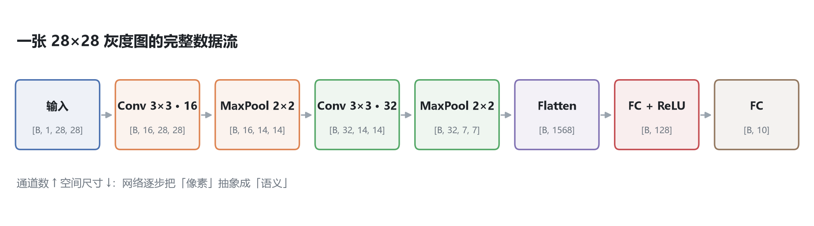
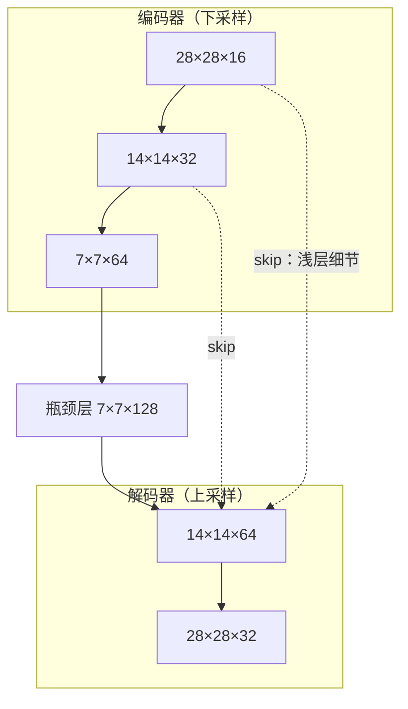

# 01 · CNN：从卷积到残差网络

> **一句话**：CNN 用「局部感受野 + 权重共享」把图像从像素逐层抽象成语义特征图。
>
> 学完这一章，应该能回答：一张 28×28 的灰度图，是怎么一步步变成 10 个类别得分的？中间每一步的张量长什么样？

| 项目 | 内容 |
| :--- | :--- |
| 学习时间 | 2026.09.28 – 10.07（约 10 天） |
| 关键词 | 卷积核 / 通道 / 特征图 / 感受野 / 池化 / 残差连接 / 迁移学习 |
| 代码 | [`code/01_cnn/`](../code/01_cnn) |
| 产出 | Fashion-MNIST 分类器、残差块形状验证、ResNet-18 微调 |

---

## 1. 数据流总览

```mermaid
flowchart LR
    A["输入<br/>[B,1,28,28]"] --> B["Conv 3×3<br/>16 核"]
    B --> C["ReLU"]
    C --> D["MaxPool 2×2"]
    D --> E["[B,16,14,14]"]
    E --> F["Conv 3×3<br/>32 核"]
    F --> G["ReLU + MaxPool"]
    G --> H["[B,32,7,7]"]
    H --> I["Flatten"]
    I --> J["[B,1568]"]
    J --> K["FC 1568→128"]
    K --> L["ReLU"]
    L --> M["FC 128→10"]
    M --> N["Logits [B,10]"]
```





| 阶段 | 张量形状 | 说明 |
| :--- | :--- | :--- |
| 输入 | `[B, 1, 28, 28]` | 单通道灰度图，像素归一化到 `[-1, 1]` |
| conv1 | `[B, 16, 28, 28]` | 16 个卷积核 → 16 张特征图，尺寸不变（padding=1） |
| pool1 | `[B, 16, 14, 14]` | 2×2 最大池化，长宽减半 |
| conv2 | `[B, 32, 14, 14]` | 32 个卷积核 |
| pool2 | `[B, 32, 7, 7]` | 再减半 |
| flatten | `[B, 1568]` | `32 × 7 × 7 = 1568` |
| fc1 | `[B, 128]` | 先降到 128 维而不是直接 10 维 |
| fc2 | `[B, 10]` | 10 类得分（logits） |

> **为什么 fc1 不直接接到 10 类？** 1568 → 10 会把特征压得太狠，中间留 128 维是为了保住非线性表达能力的"缓冲带"。

---

## 2. 卷积到底在算什么

### 2.1 一个卷积核 = 一组权重 + 一次滑窗内积

对单个输出位置：

$$
y = \sum_{c=1}^{C_{in}} \sum_{i=1}^{K} \sum_{j=1}^{K} w_{c,i,j} \cdot x_{c,i,j} + b
$$

- $K$：卷积核边长（通常 3）
- $C_{in}$：输入通道数
- 一个 3×3 卷积核作用在 3 通道输入上，其实是 **3×3×3 的立体权重块**，一次性扫过三层通道再累加

### 2.2 通道：网络的"观察角度"

- **3 通道**：RGB 三原色，等于把一张彩色图拆成三层矩阵分别扫描；医学影像常是单通道，遥感多光谱可能有几十个通道。
- **16 通道输出**：`nn.Conv2d(3, 16, 3)` 意味着有 **16 个不同的卷积核**，每个核从自己的角度审视原图，输出 16 张特征图。

```python
nn.Conv2d(in_channels=3, out_channels=16, kernel_size=3)
# 参数量 = 3 × 3 × 3 × 16 + 16 = 448
```

> 通道不是"图片的图层"，而是**网络学出来的特征维度**：第 1 个通道可能对边缘敏感，第 7 个通道可能对纹理敏感——具体含义由训练决定，人无法预先指定。

### 2.3 卷积核大小：为什么几乎总是 3×3

| 核大小 | 特点 |
| :--- | :--- |
| 1×1 | 只做通道融合（升维 / 降维），不扩大感受野 |
| 3×3 | 性价比最高：两层 3×3 的感受野等于一层 5×5，但参数更少、非线性更多 |
| 5×5 / 7×7 | 只在第一层压缩大图，或特殊结构中使用 |

两个 3×3 堆叠的感受野 = 5×5，但参数量是 $2 \times 9 = 18$ 对 $25$，而且中间多了一次激活，非线性更强。这就是 VGG 的核心结论。

### 2.4 三个必须背下来的公式

**输出尺寸**：

$$
H_{out} = \left\lfloor \frac{H_{in} + 2P - K}{S} \right\rfloor + 1
$$

**参数量**：

$$
\text{Params} = K \times K \times C_{in} \times C_{out} + C_{out}
$$

**感受野递推**（从前往后）：

$$
RF_{l} = RF_{l-1} + (K_l - 1) \times \prod_{i<l} S_i
$$

---

## 3. 感受野：为什么池化能让网络"看得更远"

一次 2×2 池化，会让后续卷积的每一步都跨过 2 个原始像素；再叠一层池化就变成 4 个。

> 原话记录：「一次池化操作，能让后面的卷积操作以倍乘的速度极快地扩大对原图的覆盖视野。」

这就是"下采样 + 加深"的动机：**用分辨率换视野**。代价是小目标信息被丢弃，所以检测 / 分割任务要靠 FPN、UNet 的跳跃连接把浅层细节接回来。

---

## 4. 激活函数与池化

### 4.1 没有激活函数，深层网络等于一层

若 $f(x)=W_2(W_1x) = (W_2W_1)x$，多层矩阵相乘在数学上仍是一个线性变换。激活函数（ReLU / GELU / Sigmoid）负责在特征空间里"折出弯折面"，网络才具备拟合非线性函数的能力。

> 记录里的比喻很准确：「一次卷积后在 0 处产生拐点，多次卷积后在 0 附近形成一条平滑曲线。」

### 4.2 最大池化 vs 平均池化

| 类型 | 行为 | 适用 |
| :--- | :--- | :--- |
| Max Pooling | 窗口内取最大值，保留最强响应 | 分类主干（默认） |
| Average Pooling | 窗口内取平均，保留整体强度 | 需要平滑特征时 |

**为什么 max 有效**：特征图里的数值越大代表该处响应越强，取最大值相当于"只要这个区域出现过这个特征，就保留下来"，天然具备一点平移不变性。

---

## 5. 网络退化与残差连接（本章最重要的一节）

### 5.1 退化不是过拟合

随着层数增加，**训练误差**反而变大——这叫退化（degradation）。原因不是参数太多，而是**恒等映射难以用堆叠的非线性层学出来**：让一堆卷积层恰好学成"什么都不做"，比想象中难。

### 5.2 残差块的做法

$$
y = \mathcal{F}(x) + x
$$

网络不再直接学目标映射 $H(x)$，而是学**残差** $\mathcal{F}(x) = H(x) - x$。

- 如果这一层没什么可学的，把 $\mathcal{F}(x)$ 压到 0 即可，$y = x$，信息原样通过；
- 反向传播时梯度可以沿 shortcut 直接回流，**即使主干的 w、b 全为 0，梯度也不会消失**。

> 记录原话：「可以设置很多卷积层，但卷积生成的特征图如果对识别有作用，那就加进去；如果这层没什么可学的，那就直接 w、b 都降为 0，忽略这层的作用。」

### 5.3 通道不一致怎么办：1×1 投影

如果输入 $x$ 是 16 通道、$\mathcal{F}(x)$ 是 32 通道，两者无法直接相加。ResNet 的解法是给 shortcut 加一个 **1×1 卷积（投影跳连）**：

```python
if stride != 1 or in_channels != out_channels:
    self.shortcut = nn.Sequential(
        nn.Conv2d(in_channels, out_channels, kernel_size=1, stride=stride, bias=False)
    )
```

| 情况 | shortcut |
| :--- | :--- |
| 通道相同、尺寸相同 | 直接 `x`（恒等映射） |
| 通道不同 或 尺寸减半 | 1×1 卷积 + stride 对齐 |

> 官方 ResNet 在卷积后还会接 BatchNorm，本仓库的 `resblock_demo.py` 为突出「加法」这一行而省略了 BN，两者形状行为一致。

### 5.4 下采样时的经典搭配

```text
空间尺寸减半  →  通道数翻倍
```

这样每层的"信息容量"大致守恒：分辨率丢一半，但每个位置的特征维度翻倍去补偿。

---

## 6. UNet：U 形结构与跳跃连接



- **左半边**：卷积 + 池化，提取高级抽象语义；
- **右半边**：上采样 + 卷积，把特征图还原回原分辨率；
- **横梁（skip connection）**：把左侧的高清浅层特征**拼接（concat）**给右侧，防止上采样把细节糊掉。

> 注意区别：ResNet 的 shortcut 是**相加**（同维度），UNet 的 skip 是**通道拼接**（维度可以不同）。

---

## 7. 迁移学习：冻结主干 + 换头

```python
model = resnet18(weights=ResNet18_Weights.DEFAULT)   # 加载 ImageNet 预训练权重
for p in model.parameters():
    p.requires_grad = False                          # 冻结全部主干
model.fc = nn.Linear(model.fc.in_features, 10)       # 换掉 1000 类分类头
optimizer = optim.Adam(model.fc.parameters(), lr=3e-3)  # 只训练新头
```

三个关键动作：

1. **白嫖权重**：ImageNet 上百万张图学到的边缘 / 纹理 / 形状先验直接复用；
2. **冻结主干**：不计算梯度、不更新参数，训练成本骤降；
3. **换头**：只训练最后一层，几百张图、几个 epoch 就能到不错的精度。

> 代价：预训练域与目标任务差异越大，迁移收益越小（例如自然图像 → 医学影像，通常需要解冻部分层做微调）。

---

## 8. 代码与形状对照

| 脚本 | 关键行 | 张量变化 | 观察点 |
| :--- | :--- | :--- | :--- |
| [`train_cnn_demo.py`](../code/01_cnn/train_cnn_demo.py) | `self.conv1` | `[B,1,28,28] → [B,16,28,28]` | 16 个核 = 16 张特征图 |
| 同上 | `self.pool1` | `[B,16,28,28] → [B,16,14,14]` | 池化只改空间尺寸，不改通道 |
| 同上 | `nn.Flatten()` | `[B,32,7,7] → [B,1568]` | 三维张量拉平成一维 |
| 同上 | 训练五步 | — | `zero_grad → forward → loss → backward → step` |
| [`predict_demo.py`](../code/01_cnn/predict_demo.py) | `unsqueeze(0)` | `[1,28,28] → [1,1,28,28]` | 单张图也要补 batch 维 |
| [`resblock_demo.py`](../code/01_cnn/resblock_demo.py) | `out + shortcut(x)` | `[1,16,28,28] + [1,16,28,28]` | 同维才能相加 |
| 同上 | `stride=2, 16→32` | `[1,16,28,28] → [1,32,14,14]` | 尺寸减半 + 通道翻倍 |
| [`transfer_learning_demo.py`](../code/01_cnn/transfer_learning_demo.py) | `model.fc = nn.Linear(512, 10)` | `[B,512] → [B,10]` | 只替换最后一层 |

---

## 9. 踩坑记录

| 报错 / 现象 | 原因 | 修法 |
| :--- | :--- | :--- |
| `RuntimeError: The size of tensor a (16) must match tensor b (32)` | 残差相加时通道数不同 | 加 1×1 投影卷积，或统一通道数 |
| 推理结果全乱 | 忘记 `model.eval()` / 忘记 `torch.no_grad()` | 推理前切换模式 |
| loss 不下降 | `optimizer.zero_grad()` 漏写，梯度累加 | 每次 backward 前清零 |
| 准确率只有 10%（等于随机） | 输入没有归一化 / 标签与输出维度对不上 | 检查 `Normalize` 与 `fc` 输出数 |
| 显存 / 内存爆掉 | batch 太大或 `pool` 后尺寸算错 | 先手推一遍 shape 再跑 |

---

## 10. 自测：8 个问题

<details>
<summary>1. 输入 3 通道、输出 16 通道、3×3 卷积，参数量是多少？</summary>

$3 \times 3 \times 3 \times 16 + 16 = 448$（每个输出通道一个 3×3×3 核，再加 16 个偏置）。
</details>

<details>
<summary>2. 两个 3×3 卷积堆叠，感受野等于多大的卷积核？参数比是多少？</summary>

感受野等价于 5×5。参数量 $2 \times 9 = 18$ 远小于 $5 \times 5 = 25$，且中间多了一次非线性。
</details>

<details>
<summary>3. 28×28 输入，K=3、S=1、P=1 的卷积，输出多大？</summary>

$\lfloor (28 + 2 - 3)/1 \rfloor + 1 = 28$，尺寸不变。这就是 "same padding"。
</details>

<details>
<summary>4. 为什么用最大池化而不是平均池化？</summary>

最大池化保留最强响应，相当于"只要该区域出现过这个特征就记住"，并带来一定平移不变性；平均池化会稀释弱特征。
</details>

<details>
<summary>5. 残差连接为什么能缓解退化？</summary>

把学习目标从 $H(x)$ 改成残差 $F(x)=H(x)-x$。无用层只需把 $F(x)$ 压到 0 就能实现恒等映射，优化难度大幅降低；同时梯度可沿 shortcut 直接回流。
</details>

<details>
<summary>6. shortcut 什么时候需要 1×1 卷积？</summary>

通道数不同，或空间尺寸因 stride 改变时。1×1 卷积负责把 $x$ 投影到与 $F(x)$ 相同的形状。
</details>

<details>
<summary>7. UNet 的 skip 和 ResNet 的 shortcut 有什么区别？</summary>

ResNet：**相加**，要求形状完全一致，目的是让梯度直达深层；UNet：**通道拼接**，把浅层高分辨率特征与深层语义融合，目的是恢复细节。
</details>

<details>
<summary>8. 迁移学习为什么要冻结主干？</summary>

减少可训练参数与显存占用，避免小数据集上过拟合，同时保留 ImageNet 学到的通用视觉先验。
</details>

---

## 11. 延伸阅读

- LeCun et al., *Gradient-Based Learning Applied to Document Recognition* (1998) —— CNN 的起点
- Simonyan & Zisserman, *Very Deep Convolutional Networks for Large-Scale Image Recognition* (VGG, 2014)
- He et al., *Deep Residual Learning for Image Recognition* (ResNet, 2016)
- Ronneberger et al., *U-Net: Convolutional Networks for Biomedical Image Segmentation* (2015)
