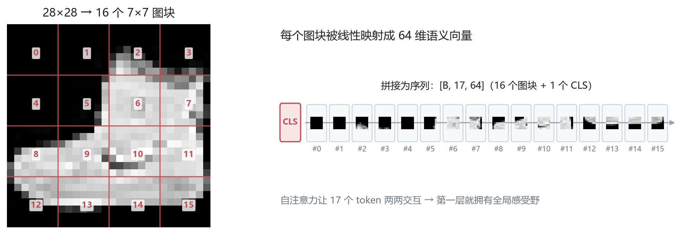
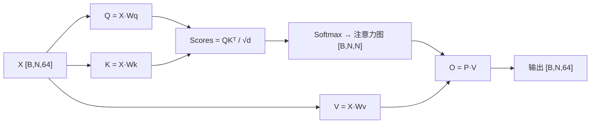

# 02 · Transformer 与 ViT：把图像当成一句话来读

> **一句话**：Transformer 把图像切成图块当"词"读，用自注意力在第一步就拿到全局感受野。
>
> 这一章是六个模块里花时间最多的：注意力机制的每一个矩阵乘法都必须亲手推一遍，否则后面 LLM 和 Diffusion 都会卡住。

| 项目 | 内容 |
| :--- | :--- |
| 学习时间 | 2026.10.07 – 10.27（约 3 周） |
| 关键词 | Patch Embedding / QKV / 自注意力 / 多头 / 位置编码 / CLS Token / 因果掩码 |
| 代码 | [`code/02_transformer/`](../code/02_transformer) |
| 产出 | 手写 MHA、手写完整 ViT、Fashion-MNIST 上从零训练 ViT、注意力权重可视化 |

---

## 1. 从一句话到一张图

Transformer 最初处理的是**一维序列**（"我 爱 深度 学习"），自注意力让每个词都能直接看到句子里所有其他词。

图片不是序列，怎么办？



**Patch Embedding（图块嵌入）** 两步走：

1. **切片**：28×28 的图，每块 7×7 → 长宽各 4 块 → 共 **16 个图块**，每块 49 个像素；
2. **映射**：用一层线性变换（实现上就是 `kernel_size=patch_size, stride=patch_size` 的卷积）把 49 维映射到 64 维语义空间。

| 阶段 | 形状 | 说明 |
| :--- | :--- | :--- |
| 原图 | `[B, 1, 28, 28]` | 灰度图 |
| 卷积切块 | `[B, 64, 4, 4]` | 16 个 patch，每个已经变成 64 维 |
| flatten + transpose | `[B, 16, 64]` | 变成"16 个词、每个词 64 维"的序列 |

> 那 49 个像素是怎么变成 64 维的？靠可学习的权重矩阵 $W$。训练完成后，这 64 个数字不再是像素强弱，而是**该图块的高级语义描述**（纹理粗细、是否有弧角、反光强度……）。

---

## 2. 自注意力：一次矩阵乘法换全局视野



三步走：

1. **打分**：每个图块的 Q 与其他所有图块的 K 做点积，得到长度 N 的相关性向量；
2. **归一化**：softmax 把打分变成和为 1 的权重（注意力图，16×16）；
3. **聚合**：用权重对所有 V 加权求和，得到每个图块的新特征。

$$
\text{Attention}(Q,K,V) = \text{softmax}\!\left(\frac{QK^\top}{\sqrt{d_k}}\right)V
$$

**Q、K、V 是哪来的？** 不是手工设计的，而是三个 `nn.Linear`，随机初始化、随训练更新——它们就是模型自己学出来的"提问方式、被检索的标签、被取走的内容"。

**为什么除以 $\sqrt{d_k}$？** 点积的方差随维度线性增长，不缩放会让 softmax 进入饱和区（几乎 one-hot），梯度消失。

---

## 3. 位置编码与 CLS Token

### 3.1 为什么需要位置编码

自注意力把输入当成**集合**：打乱图块顺序，两两打分完全不变（**置换不变性**）。模型根本不知道哪块在左上、哪块在右下。

解决：给每个图块加一个可学习的位置向量 `pos_embed`，形状 `[1, 17, 64]`（16 个图块 + 1 个 CLS），逐元素相加。

### 3.2 CLS Token 是什么

输入 17 个 token，输出还是 17 个。分类该用哪一个？

ViT 抄了 BERT 的做法：在最前面拼一个**可学习的 [CLS] Token**，让它和所有图块做注意力，最后由它一个人代表整张图去分类。

```python
x = torch.cat((cls_tokens, x), dim=1)   # [B, 17, 64]
x = x + self.pos_embed                  # 位置信息
...
cls_out = x[:, 0]                       # 只取第 0 个位置
```

> 记录里的比喻：「CLS 是班长，负责收集全班意见后去交卷。」

---

## 4. 多头注意力：不是把计算量乘 8

### 4.1 单头的局限

一张 16×16 的打分表只能表达**一种**关系。图块 1 若把最高分给了"颜色相似"的块，就没法同时关注"轮廓相连"或"左右对称"的块。

### 4.2 切蛋糕分工制

设 `embed_dim=64`、`num_heads=4`，则每个头分到 `head_dim=16`：

```text
[B, 17, 64]
   ↓ view + transpose
[B, 4, 17, 16]        ← 4 个头并行
   ↓ 各自算注意力
[B, 4, 17, 16]
   ↓ transpose + view（拼接）
[B, 17, 64]
   ↓ out_proj
[B, 17, 64]
```

**关键结论**：把 64 维切成 4 份，每个头只算 16 维——总参数量、总计算量几乎不变，但模型获得了 4 个独立的子空间视角。

### 4.3 实现细节（形状最容易错的地方）

```python
Q = self.q_proj(x)                                    # [B, N, 64]
Q = Q.view(B, N, self.num_heads, self.head_dim)       # [B, N, 4, 16]
Q = Q.transpose(1, 2)                                 # [B, 4, N, 16]
...
context = context.transpose(1, 2).contiguous().view(B, N, 64)
```

`transpose` 之后内存不连续，必须 `.contiguous()` 才能 `view`，否则报 `view size is not compatible`。

---

## 5. LayerNorm 还是 BatchNorm？

| | BatchNorm | LayerNorm |
| :--- | :--- | :--- |
| 统计维度 | 跨样本（batch 维） | 单个样本内部（特征维） |
| 输入形状 | `[B, C, ...]` | 任意，通常 `[..., D]` |
| batch=1 时 | 训练会报错（方差为 0） | 正常工作 |
| 序列长度变化 | 需要转置对齐，很别扭 | 天然适配 |
| 典型使用者 | CNN | Transformer |

Transformer 选 LayerNorm 的根本原因：**序列长度可变、batch 可能很小、推理时是逐 token 生成的**——这三种情况 BN 都不适用。

```python
ln = nn.LayerNorm(4)          # 对最后一维（4 个特征）做归一化
bn = nn.BatchNorm1d(4)        # 对 batch 维统计，batch=1 会炸
```

---

## 6. 因果注意力：不许偷看未来

语言模型的任务是"根据前文预测下一个词"。如果注意力能看到后面的词，等于考试时翻答案。

掩码做法：构造上三角布尔矩阵，把"未来"位置置为 `-inf`，softmax 之后自然变成 0。

```python
mask = torch.triu(torch.ones(N, N), diagonal=1).bool()
scores = scores.masked_fill(mask, float('-inf'))
attn = torch.softmax(scores, dim=-1)   # 变成标准下三角矩阵
```

```text
      t1   t2   t3   t4
t1 [ 1.0  0    0    0  ]
t2 [ 0.5  0.5  0    0  ]
t3 [ .3   .3   .4   0  ]
t4 [ .2   .2   .3   .3 ]
```

> 这就是 GPT 类模型能"逐词生成"的结构基础：第 t 个位置永远只能看到 1..t。

---

## 7. ViT vs CNN：归纳偏置的取舍

| | CNN | ViT |
| :--- | :--- | :--- |
| 先验 | 强：局部性 + 平移不变性（硬编码在卷积核里） | 弱：一张白纸，对空间拓扑无假设 |
| 小数据 | 表现好，收敛快 | 容易过拟合 |
| 大数据 | 上限受限 | 上限极高（GPT / ViT-22B 证明了这一点） |
| 全局关系 | 需要堆很多层才能覆盖全图 | 第一层就全局可见 |

> 一句话：**CNN 把"图像应该是局部的"写进了结构，ViT 把这件事交给数据去学。**

---

## 8. 代码与形状对照

| 脚本 | 关键行 | 张量变化 | 观察点 |
| :--- | :--- | :--- | :--- |
| [`patch_embed_demo.py`](../code/02_transformer/patch_embed_demo.py) | `unfold / Conv2d` | `[B,1,28,28] → [B,16,49]` | 切块后每个 patch 拉平 |
| [`self_attention_demo.py`](../code/02_transformer/self_attention_demo.py) | `Q @ K.T` | `[1,16,64]×[1,64,16] → [1,16,16]` | 打分矩阵的每一行和为 1 |
| [`mha_demo.py`](../code/02_transformer/mha_demo.py) | `view + transpose` | `[B,17,64] → [B,4,17,16]` | 4 个头并行，输出拼回 64 |
| [`norm_comparison_demo.py`](../code/02_transformer/norm_comparison_demo.py) | `LayerNorm(4)` | `[2,3,4] → [2,3,4]` | 每个 token 内部均值≈0、方差≈1 |
| [`causal_attention_demo.py`](../code/02_transformer/causal_attention_demo.py) | `triu + masked_fill` | `[N,N] → 下三角` | 上三角全为 0 |
| [`vit_complete_demo.py`](../code/02_transformer/vit_complete_demo.py) | 完整前向 | `[1,1,28,28] → [1,10]` | CLS 取 `x[:, 0]` |
| [`train_vit_demo.py`](../code/02_transformer/train_vit_demo.py) | 训练循环 | loss 下降 | 2000 张图、2 epoch 的快速验证 |

---

## 9. 踩坑记录

| 报错 / 现象 | 原因 | 修法 |
| :--- | :--- | :--- |
| `view size is not compatible with input tensor's size and stride` | `transpose` 后直接 `view` | 先 `.contiguous()` |
| `softmax` 输出全是 `nan` | 掩码用了 `-1e9` 但某一行全是 `-inf` | 保证每行至少有一个可看的位置 |
| 模型完全学不会位置关系 | 忘记加 `pos_embed` | 检查是否 `x = x + pos_embed` |
| 分类准确率不涨 | 取了所有 token 做平均而不是 CLS | 只取 `x[:, 0]` |
| ViT 在小数据上过拟合 | 没有正则 / 数据增强 | 加 weight decay、dropout，或用预训练权重 |

---

## 10. 自测：8 个问题

<details>
<summary>1. 28×28 的图、patch=7，得到多少个 token？每个 token 多少维（embed=64）？</summary>

$(28/7)^2 = 16$ 个 patch，每个映射为 64 维；加上 CLS 后序列长度是 17。
</details>

<details>
<summary>2. 自注意力的计算复杂度是多少？</summary>

$O(N^2 d)$：$N$ 个 token 两两打分。这也是长序列场景（高分辨率图像、长文本）的主要瓶颈。
</details>

<details>
<summary>3. 为什么多头不增加参数量？</summary>

总维度不变，只是切成 $h$ 份、每份 $d/h$ 维并行计算，拼接后再过一层输出投影。总参数量与单头基本相同。
</details>

<details>
<summary>4. 位置编码为什么不能省？</summary>

自注意力对输入顺序不敏感（置换不变），没有位置编码时模型无法区分"左上角的块"和"右下角的块"。
</details>

<details>
<summary>5. CLS Token 的作用是什么？</summary>

作为一个可学习的"汇总位"，通过注意力收集所有 patch 的信息，最后只用它的输出做分类，避免对 16 个 patch 做池化带来的信息损失。
</details>

<details>
<summary>6. Transformer 为什么用 LayerNorm 而不是 BatchNorm？</summary>

序列长度可变、batch 可能很小、推理时逐 token 生成，BN 的跨样本统计在这些场景下不稳定甚至不可用；LN 在单个样本内部归一化，天然适配。
</details>

<details>
<summary>7. 因果掩码的作用？</summary>

把当前位置之后的所有 token 打分置为 $-\infty$，softmax 后权重为 0，保证生成时只能看到前文。
</details>

<details>
<summary>8. ViT 为什么需要海量数据？</summary>

缺少卷积的局部性与平移不变性先验，模型必须从数据中自己学出这些规律，因此小数据容易过拟合，大数据上上限更高。
</details>

---

## 11. 延伸阅读

- Vaswani et al., *Attention Is All You Need* (2017)
- Dosovitskiy et al., *An Image is Worth 16x16 Words: Transformers for Image Recognition at Scale* (ViT, 2021)
- Devlin et al., *BERT* (2019) —— CLS token 的来源
- Xiong et al., *On Layer Normalization in the Transformer Architecture* (2020)
