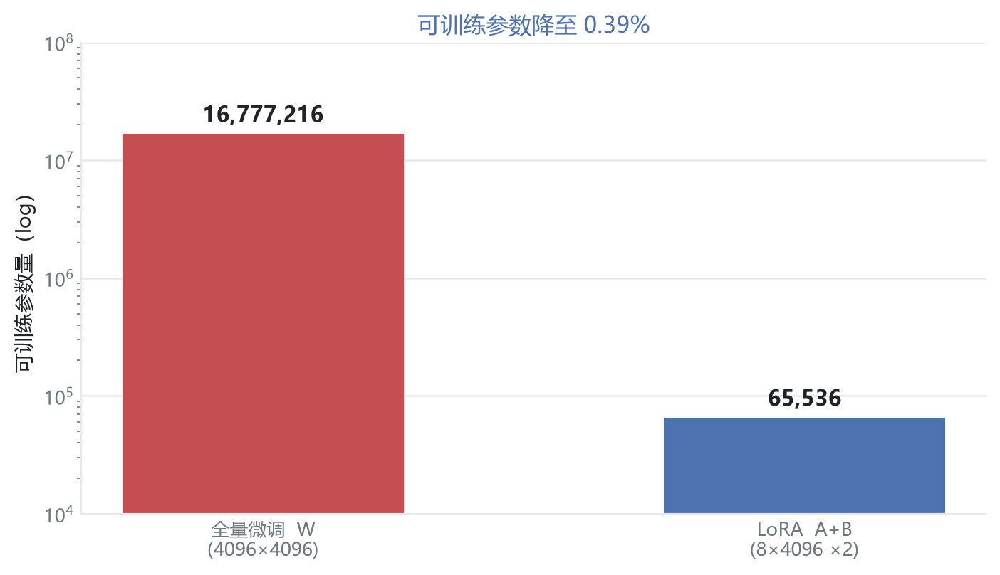
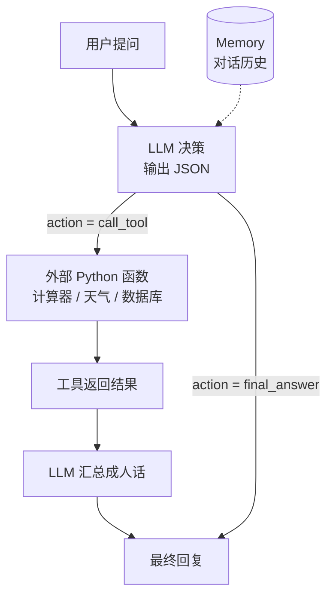

# 03 · LLM 与 Agent：从预测下一个词到调用工具

> **一句话**：大语言模型本质是一台"预测下一个 Token"的机器；给它接上工具和记忆，它就成了 Agent。
>
> 这一章的目标不是"会用 ChatGPT"，而是能说清：一句话是怎么变成整数 ID、怎么变成向量、怎么被注意力处理、最后怎么变回文字的。

| 项目 | 内容 |
| :--- | :--- |
| 学习时间 | 2026.10.27 – 10.29 |
| 关键词 | Embedding / Tokenizer / 自回归 / KV / LoRA / Function Calling / 对齐 |
| 代码 | [`code/03_llm_agent/`](../code/03_llm_agent) |
| 产出 | Token 全流程 Demo、自回归生成循环、LoRA 参数账、极简 Agent 运行时 |

---

## 1. 一句话进入模型的完整旅程


| 阶段 | 张量形状 | 说明 |
| :--- | :--- | :--- |
| 文本 | `"我 爱 深度 学习"` | 人类语言 |
| Tokenizer | `[1, 4]` | 4 个整数 ID |
| Embedding | `[1, 4, 32]` | 每个 ID 查表得到 32 维向量 |
| 因果注意力 | `[1, 4, 32]` | 每个位置只能看自己及之前 |
| LM Head | `[1, 4, 1000]` | 在整个词表上打分 |
| 采样 | `[1, 1]` | 取最后一个位置 |

> 自回归的本质：把预测出的词**拼回输入末尾**，再跑一遍。循环 N 次就生成长度 N 的句子。

---

## 2. Transformer 里的 MLP：为什么先升维再降维

自注意力负责"横向交流"（token 之间交换信息），MLP 负责"纵向消化"（每个 token 独立提炼）。

```text
Linear(d → 4d) → GELU → Linear(4d → d)
```

三个问题：

**① 为什么先升维？**
低维空间里复杂特征纠缠在一起（二维平面上很难用一条直线分开缠绕的数据点）。升到 4 倍维度相当于"把揉皱的纸团在高维空间撑开"，线性不可分的特征更容易被分开。

**② 为什么紧接激活函数？**
没有激活，连续两次矩阵乘法 $W_2(W_1x)$ 在数学上等价于一次矩阵乘法，升维毫无意义。GELU 在高维空间里"切出弯曲的折面"，才真正实现非线性提炼。

**③ 为什么又要降回去？**
两个硬约束：残差连接要求 $x + \text{MLP}(x)$ 形状完全一致；而且如果一直保持 4d，下一层注意力的 $O(N^2 d)$ 计算量会暴涨。

> 一句话：**局部升维充分提炼，提炼完立刻压缩打包**。

---

## 3. nn.Embedding：一张巨大的查找表

```python
emb = nn.Embedding(num_embeddings=50000, embedding_dim=64)  # 形状 [50000, 64]
x = emb(input_ids)                                          # [B, L] -> [B, L, 64]
```

底层就是一张 `[词表大小, 隐藏维度]` 的静态权重矩阵，输入 ID 2356 就取出第 2356 行。

**为什么不能直接用 ID？** ID 只是序号，`2356` 和 `2357` 之间没有任何数学关系；查表得到的 64 维向量才有距离、方向、可求导的语义结构。

---

## 4. Tokenizer：BPE 与 WordPiece

| 粒度 | 优点 | 缺点 |
| :--- | :--- | :--- |
| 字符级 | 词表小，无 OOV | 序列太长 |
| 词级 | 序列短 | 词表爆炸，无法处理新词 |
| 子词级（BPE / WordPiece） | 折中：常见词整块，罕见词拆开 | 需要训练分词表 |

BPE（Byte-Pair Encoding）的核心是"反复把出现频率最高的相邻符号对合并成一个新符号"，直到达到目标词表大小。GPT / LLaMA 系列都用它。

---

## 5. Hugging Face：开源模型的"应用商店"

| 组件 | 作用 |
| :--- | :--- |
| **Model Hub** | 托管 LLaMA、DeepSeek、Stable Diffusion 等模型权重 |
| **transformers** | `AutoTokenizer` / `AutoModel` 统一了 99% 主流架构的加载接口 |
| **datasets / peft** | 数据集与参数高效微调工具 |

> 以前：去 GitHub 找源码 → 找作者要权重 → 自己写配置。现在：三行代码加载。

---

## 6. 对齐：让图和文说同一种语言

图像进 ViT 得到一个视觉向量，文本进 LLM 得到一个语言向量，它们原本是两个平行宇宙。

**CLIP 的做法**：用对比学习把配对的（图，文）拉近、不配对的推远，使"狗的照片"和"一只柴犬"在同一向量空间里余弦相似度接近 1。

> 对齐不是为了更快或更省 Token，而是为了**打通语义**：只有向量对齐了，输入一句 Prompt 才能指挥模型生成对应的图像或 3D 场景。

---

## 7. 微调：SFT 与 LoRA

### 7.1 为什么需要微调

基座模型只会"接龙"，不经驯化会一本正经地胡说。SFT（监督微调）用「指令 → 回答」配对数据把它调成"助手"。

### 7.2 LoRA：只训练 0.39% 的参数

假设注意力层有一个 $4096 \times 4096$ 的投影矩阵：

| 方案 | 参数量 | 占比 |
| :--- | ---: | ---: |
| 全量微调 $W$ | $4096^2 = 16{,}777{,}216$ | 100% |
| LoRA $A_{8\times4096} + B_{4096\times8}$ | $65{,}536$ | **0.39%** |

$$
h = Wx + \frac{\alpha}{r} \cdot BAx
$$

实现要点：

- $W$ **冻结**，不计算梯度；
- $A$ 高斯随机初始化，$B$ **全零初始化**（保证训练开始时旁路输出为 0，不破坏原模型）；
- $r$ 通常取 4 / 8 / 16；
- 训练完后可把 $BA$ 加回 $W$，推理**零额外延迟**。



---

## 8. Agent：LLM + 工具 + 记忆



**Agent = LLM（大脑）+ Tools（四肢）+ Memory（记忆）**

关键机制是 **Function Calling**：模型不直接"算"，而是输出一段结构化 JSON：

```json
{
  "action": "call_tool",
  "tool_name": "get_current_city_weather",
  "tool_args": {"city": "杭州"}
}
```

外部解释器读到 JSON 后执行真实函数，再把结果塞回上下文。**JSON 就是模型与外部世界之间的通信协议。**

> 这也解释了为什么大模型"算术不好"却"用得很好"：它不需要会算，只需要知道该调用谁。

---

## 9. 代码与形状对照

| 脚本 | 关键点 | 张量变化 | 观察 |
| :--- | :--- | :--- | :--- |
| [`token_flow_demo.py`](../code/03_llm_agent/token_flow_demo.py) | 文本→ID→向量→logits | `[1,4] → [1,4,32] → [1,4,1000]` | 词表维度在最后 |
| [`autoregressive_loop_demo.py`](../code/03_llm_agent/autoregressive_loop_demo.py) | `torch.cat` 拼接 | `[1,3] → [1,4] → [1,5]` | 每步只取最后一位 |
| [`lora_toy_demo.py`](../code/03_llm_agent/lora_toy_demo.py) | 冻结 $W$ + 低秩旁路 | 输出形状不变 | 打印可训练参数占比 |
| [`simple_agent_demo.py`](../code/03_llm_agent/simple_agent_demo.py) | JSON 协议 | 无张量 | 观察工具调用与结果回传 |

---

## 10. 踩坑记录

| 现象 | 原因 | 修法 |
| :--- | :--- | :--- |
| 生成的句子是乱码 | 模型未训练，`argmax` 只是随机挑 | 用预训练权重；玩具模型只看"机制"不看"效果" |
| 每次输出都不一样 | 用了随机采样且没有 `torch.manual_seed` | 固定种子，或改 `model.eval()` |
| loss 不下降 | 忘记 `model.train()` / 学习率过大 | 检查模式与 lr |
| LoRA 训练后效果反而变差 | $B$ 没有零初始化，一开始就破坏了主干 | `nn.Parameter(torch.zeros(...))` |
| Agent 调错工具 | Prompt 里工具描述不清 / JSON 格式约束不足 | 用 JSON Schema 约束输出 |

> ⚠️ 安全提示：`simple_agent_demo.py` 里的 `eval()` 仅用于教学演示。真实项目中必须换成安全的表达式解析器，绝不能把模型输出直接丢进 `eval`。

---

## 11. 自测：7 个问题

<details>
<summary>1. 一个 50000 词表、64 维的 Embedding 层有多少参数？</summary>

$50000 \times 64 = 3{,}200{,}000$。
</details>

<details>
<summary>2. 为什么 Transformer 的 MLP 要先升维到 4 倍？</summary>

把纠缠的低维特征投影到更宽的高维空间，配合激活函数更容易被非线性边界分开；同时控制计算量——只在 MLP 内部短暂扩张，不带到下一层注意力。
</details>

<details>
<summary>3. 自回归生成时为什么只取最后一个位置的输出？</summary>

因为因果注意力保证第 $t$ 个位置的输出只依赖前 $t$ 个 token，最后一位恰好汇总了整段上下文，用它预测下一个词。
</details>

<details>
<summary>4. LoRA 的 $B$ 为什么初始化为 0？</summary>

使训练开始时 $BAx = 0$，模型输出与原始预训练模型完全一致，避免随机初始化的旁路破坏已有能力。
</details>

<details>
<summary>5. 全量微调和 LoRA 的显存差异主要来自哪里？</summary>

全量微调需要为全部参数保存梯度与优化器状态（Adam 还要两份动量）；LoRA 只更新极少量参数，主干不存梯度。
</details>

<details>
<summary>6. Agent 和普通 Chatbot 的本质区别？</summary>

Chatbot 只生成文本；Agent 能**决定调用外部工具**并利用返回结果继续推理，形成"感知—决策—行动"的闭环。
</details>

<details>
<summary>7. 为什么说"对齐"是多模态生成的 prerequisite？</summary>

生成模型需要用文本向量去引导图像/3D 的生成过程；只有图文向量处于同一语义空间，文本条件才有意义。
</details>

---

## 12. 延伸阅读

- Vaswani et al., *Attention Is All You Need* (2017)
- Radford et al., *Learning Transferable Visual Models From Natural Language Supervision* (CLIP, 2021)
- Hu et al., *LoRA: Low-Rank Adaptation of Large Language Models* (2021)
- Yao et al., *ReAct: Synergizing Reasoning and Acting in Language Models* (2022)
