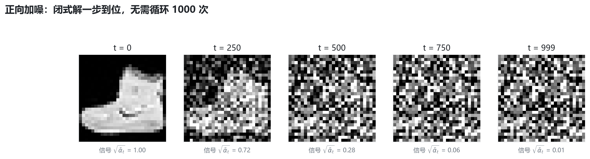
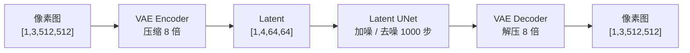

# 04 · Diffusion：从雪花屏里"长"出一张图

> **一句话**：先教会网络"认出自己加的噪声"，再让它一步步把噪声擦掉，图像就从纯随机里浮现出来。
>
> 这一章的数学看起来吓人，但真正需要记住的只有两个公式：**正向的闭式解**与**反向的单步去噪**。

| 项目 | 内容 |
| :--- | :--- |
| 学习时间 | 2026.10.28 – 10.29 |
| 关键词 | 闭式加噪 / ᾱ 调度 / UNet / 跳跃连接 / DDPM 采样 / CFG / Latent Diffusion |
| 代码 | [`code/04_diffusion/`](../code/04_diffusion) |
| 产出 | 加噪可视化、UNet 噪声预测、DDPM 采样循环、CFG 引导、潜空间压缩 |

---

## 1. 直觉：为什么不是"一步画出来"

| 路线 | 做法 | 问题 |
| :--- | :--- | :--- |
| GAN | 生成器一次画出整张图 | 训练不稳定，模式崩塌 |
| 自回归 | 逐像素预测 | 序列太长，速度慢 |
| **Diffusion** | 先把图"破坏"成噪声，再学着**逐步修复** | 采样慢，但训练稳定、覆盖度高 |

打个比方：让画家在白纸上直接画出《蒙娜丽莎》很难；但如果给他一张被泼了墨的画，让他"每次擦掉一点墨"，就简单得多——**去噪比凭空生成容易**。

---

## 2. 正向过程：加噪不需要 for 循环



DDPM 推导出了一个闭式解，可以直接算出**任意第 t 步**的加噪结果：

$$
q(x_t \mid x_0) = \mathcal{N}\!\left(\sqrt{\bar\alpha_t}\,x_0,\ (1-\bar\alpha_t)\,I\right)
$$

写成代码只有一行：

$$
x_t = \sqrt{\bar\alpha_t}\, x_0 + \sqrt{1-\bar\alpha_t}\, \epsilon,\qquad \epsilon \sim \mathcal{N}(0, I)
$$

| 符号 | 含义 |
| :--- | :--- |
| $x_0$ | 干净原图 |
| $\epsilon$ | 标准高斯噪声（"胡椒面"） |
| $\beta_t$ | 第 t 步加入的噪声比例，从 0.0001 线性增到 0.02 |
| $\alpha_t = 1-\beta_t$ | 第 t 步保留的信号比例 |
| $\bar\alpha_t = \prod_{s\le t}\alpha_s$ | 累积保留比例，从 1 衰减到 ≈0 |

**物理直觉**：
- $t=0$：$\bar\alpha \approx 1$，原图 100%，噪声 0%；
- $t=999$：$\bar\alpha \approx 0$，原图 0%，纯雪花屏。

> 这个闭式解是扩散模型能大规模训练的前提：不需要真的循环 1000 次加噪，一次算术运算就能采样任意时刻的训练样本。

---

## 3. 反向过程：网络只学一件事——猜噪声

### 3.1 训练

```text
1. 取一张干净图 x0
2. 随机采一个时间步 t
3. 采样噪声 ε，用闭式解算出 x_t
4. 把 (x_t, t) 喂给 UNet，让它预测 ε̂
5. loss = MSE(ε, ε̂)  →  反向传播
```

> 网络不需要学会"画出干净图"，它只要能猜出"刚才被倒进去的是哪一团胡椒面"。

### 3.2 UNet 为什么长这样

| 层级 | 编码器（下采样） | 跳跃连接 | 解码器（上采样） |
| :--- | :--- | :--- | :--- |
| 浅层细节 | 输入加噪图 `[B,1,28,28]` | ────────→ | 输出预测噪声 `[B,1,28,28]` |
| 中层轮廓 | 特征图 `[B,32,14,14]` | ────────→ | 还原 `[B,32,14,14]` |
| 深层抽象 | 特征图 `[B,64,7,7]` | ────────→ | 还原 `[B,64,7,7]` |
| 瓶颈 | ↘ 压缩到最深处（全局语义） | | ↗ 准备放大还原细节 |

- **下采样**：缩小尺寸、增大通道，"远眺"看全图轮廓；
- **上采样**：放大尺寸，还原像素级细节；
- **跳跃连接**：把左侧的浅层高清特征直接拼给右侧（`torch.cat`），这是预测噪声能保持像素级精度的关键。

### 3.3 反向的单步公式

$$
x_{t-1} = \frac{1}{\sqrt{\alpha_t}}\left(x_t - \frac{1-\alpha_t}{\sqrt{1-\bar\alpha_t}}\,\epsilon_\theta(x_t,t)\right) + \sigma_t z
$$

三步人话拆解：

1. **算出主体**：把网络猜出的噪声按比例扣掉；
2. **缩放回原尺度**：除以 $\sqrt{\alpha_t}$；
3. **加回微量扰动**：$t>0$ 时加一点点随机噪声 $z$，防止某一步走极端、增加生成多样性；$t=0$ 时不加。

### 3.4 为什么不能一步到位

在 $t=999$ 时，图里几乎没有原始信号，网络只能猜出一个**非常粗糙、带幻觉**的轮廓。如果直接减掉它，得到的是一团模糊色块。

所以必须**小步慢跑**：每次只擦掉一点，擦 1000 次，细节逐层凝聚。

---

## 4. 条件生成：让模型"听话地画"

### 4.1 把文字注入 UNet

```text
文本 "一双红色的运动鞋"
   ↓ Text Encoder（CLIP / T5）
条件向量 c [B, 77, 768]
   ↓ Cross-Attention（作为 K、V 注入 UNet 中间层）
UNet 在预测噪声时偏向"红鞋"方向
```

### 4.2 CFG：把"一点点方向偏移"放大

```text
ε_uncond = UNet(x_t, ∅)        # 不给条件，自由发散
ε_cond   = UNet(x_t, c)        # 给条件，听提示词
ε_final  = ε_uncond + s · (ε_cond − ε_uncond)
```

- $s$ = CFG Scale，通常 7.0 ~ 9.0；
- $s=1$ 等价于纯条件生成；$s$ 过大（>15）会导致过饱和、色彩崩坏；
- 代价：每一步要跑两次 UNet，推理成本翻倍。

---

## 5. Latent Diffusion：Stable Diffusion 的真正底座

### 5.1 像素扩散太贵

一张 512×512 的 RGB 图有 $512 \times 512 \times 3 = 786{,}432$ 个数值。在这个尺度上反复做卷积与注意力，显存和速度都吃不消；而且白墙的细微颗粒这类**人眼看不清的高频冗余**，也被无差别地加噪去噪了 1000 步。

### 5.2 双层分工



| 空间 | 数值个数 | 说明 |
| :--- | ---: | :--- |
| 像素空间 | 786,432 | 原始计算量 |
| 潜空间 | 16,384 | 缩小到 **2%** |

关键点：VAE 是**预训练好并冻结**的，不参与扩散训练；扩散全过程只发生在 64×64 的潜空间里，最后才解码一次。

---

## 6. 代码与形状对照

| 脚本 | 关键行 | 张量变化 | 观察 |
| :--- | :--- | :--- | :--- |
| [`forward_diffusion_demo.py`](../code/04_diffusion/forward_diffusion_demo.py) | `add_noise` | `[1,1,28,28]` 不变 | 打印各 t 的信号/噪声比例 |
| [`unet_denoise_toy.py`](../code/04_diffusion/unet_denoise_toy.py) | `torch.cat([up, feat1])` | `[B,32,28,28]+[B,16,28,28] → [B,48,28,28]` | 跳跃连接是通道拼接 |
| [`diffusion_sampling_demo.py`](../code/04_diffusion/diffusion_sampling_demo.py) | `x = mean + sigma_t·z` | `[1,1,28,28]` 不变 | 逐步去噪，均值/方差变化 |
| [`cfg_condition_demo.py`](../code/04_diffusion/cfg_condition_demo.py) | `eps_u + s·(eps_c − eps_u)` | `[1,1,28,28]` 不变 | 对比方差放大效果 |
| [`latent_diffusion_toy.py`](../code/04_diffusion/latent_diffusion_toy.py) | `vae.encode` | `[1,3,512,512] → [1,4,64,64]` | 体积降到 2% |

> ⚠️ **重要说明**：`diffusion_sampling_demo.py` 中的 UNet 是**随机初始化、未训练**的，它演示的是采样循环的数学行为，输出仍然接近噪声——这是刻意设计，不是 bug。想看真实生成效果需要先训练（或加载预训练权重）。

---

## 7. 踩坑记录

| 现象 | 原因 | 修法 |
| :--- | :--- | :--- |
| 采样出来还是噪声 | 网络未训练 / 权重未加载 | 先训练，或换预训练权重 |
| 训练 loss 很快到 0 | 输入未归一化到 `[-1,1]` 或 t 采样有误 | 检查 `Normalize((0.5,),(0.5,))` |
| 图像发灰、对比度低 | 采样步数与训练时的 timesteps 不一致 | 保持 scheduler 配置一致 |
| 显存爆炸 | 在像素空间跑大分辨率 | 改用 Latent Diffusion |
| 生成结果过饱和 | CFG scale 太大 | 降到 7 左右 |

---

## 8. 自测：8 个问题

<details>
<summary>1. 为什么正向加噪可以一步算出来？</summary>

因为每步加的都是独立高斯噪声，多个高斯分布叠加仍是高斯分布，可以解析地合并成 $\bar\alpha_t$，得到闭式解。
</details>

<details>
<summary>2. 扩散模型训练的 loss 是什么？</summary>

预测噪声与真实噪声之间的均方误差 $\mathbb{E}\|\epsilon - \epsilon_\theta(x_t,t)\|^2$。
</details>

<details>
<summary>3. 为什么不直接预测干净图 $x_0$？</summary>

在 $t$ 很大时 $x_0$ 的信噪比极低，直接回归 $x_0$ 的梯度不稳定；预测噪声等价于预测"残差"，数值更稳定，也是 DDPM 论文的推荐参数化。
</details>

<details>
<summary>4. UNet 的跳跃连接为什么重要？</summary>

下采样丢失空间细节，跳跃连接把浅层高分辨率特征直接拼给解码器，保证预测的噪声有像素级精度。
</details>

<details>
<summary>5. 采样时为什么还要加随机噪声 $z$？</summary>

对应朗之万动力学的随机项，增加生成多样性并避免某一步走偏；$t=0$ 时不再加，保证输出确定。
</details>

<details>
<summary>6. CFG 的公式与代价？</summary>

$\epsilon = \epsilon_{uncond} + s(\epsilon_{cond} - \epsilon_{uncond})$；每步需要两次前向，推理成本约翻倍。
</details>

<details>
<summary>7. Latent Diffusion 省了多少计算？</summary>

512×512×3 压缩到 64×64×4，数值量从 78 万降到 1.6 万，约 2%；同时去掉了大量人眼不可见的高频冗余。
</details>

<details>
<summary>8. VAE 在 LDM 里参与训练吗？</summary>

不参与。VAE 是提前训练好并冻结的编码器/解码器，扩散训练只优化潜空间的 UNet。
</details>

---

## 9. 延伸阅读

- Ho et al., *Denoising Diffusion Probabilistic Models* (DDPM, 2020)
- Song et al., *Score-Based Generative Modeling through Stochastic Differential Equations* (2021)
- Ho & Salimans, *Classifier-Free Diffusion Guidance* (2021)
- Rombach et al., *High-Resolution Image Synthesis with Latent Diffusion Models* (Stable Diffusion, 2022)
