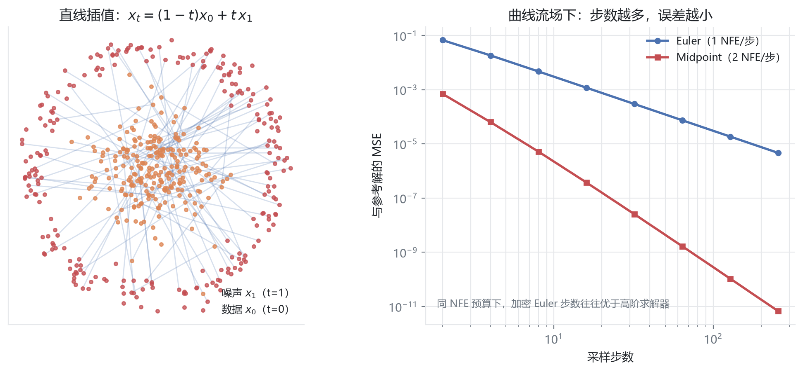

# 05 · Flow Matching：把弯曲的去噪路拉成直线

> **一句话**：Diffusion 像醉汉一样边走边抖，Flow Matching 直接学一个"速度场"，沿直线把噪声推成数据。
>
> 这一章可以看作是 Diffusion 的"几何重写"：不再预测噪声，而是预测**速度**。

| 项目 | 内容 |
| :--- | :--- |
| 学习时间 | 2026.10.29 |
| 关键词 | 直线插值 / 速度场 / ODE / Euler / Midpoint / RK4 / NFE |
| 代码 | [`code/05_flow_matching/`](../code/05_flow_matching) |
| 产出 | 2D 直线流训练、Euler 采样、三阶求解器误差对比 |

---

## 1. 为什么需要 Flow Matching

| | Diffusion（SDE） | Flow Matching（ODE） |
| :--- | :--- | :--- |
| 数学工具 | 随机微分方程 | 常微分方程 |
| 轨迹 | 布朗运动，弯曲、来回抖 | 尽量拉直（最优传输路径） |
| 采样步数 | 通常 50–1000 步 | 1–20 步即可 |
| 随机性 | 每步注入噪声 | 完全确定性 |
| 代表模型 | Stable Diffusion 1.x/2.x | SD3、Flux、Sora |

> 核心动机：**推理慢的根源是轨迹弯**。如果噪声到数据的路径是直线，那么用很少的步数就能走完。

---

## 2. 核心：直线插值与恒定速度



给定一个真实样本 $x_0$ 和一个噪声样本 $x_1$，在 $t \in [0,1]$ 上做线性插值：

$$
x_t = (1-t)\,x_0 + t\,x_1
$$

对时间求导，得到这条直线的**恒定速度**：

$$
v_{\text{target}} = \frac{dx_t}{dt} = x_1 - x_0
$$

训练目标就是让网络 $v_\theta(x_t, t)$ 逼近它：

$$
\mathcal{L} = \mathbb{E}_{t,x_0,x_1}\left\| v_\theta(x_t,t) - (x_1 - x_0) \right\|^2
$$

| 符号 | 含义 |
| :--- | :--- |
| $x_0$ | 真实数据（$t=0$） |
| $x_1$ | 纯高斯噪声（$t=1$） |
| $x_t$ | 中间状态 |
| $v$ | 从噪声指向数据的瞬时速度 |

> 对比 DDPM：那边预测"噪声 $\epsilon$"，这边预测"速度 $v$"。两者在数学上可以互相换算，但 FM 的损失目标更简洁、轨迹更直。

---

## 3. 采样：一个初中物理公式

### 3.1 一阶欧拉法

从 $t=1$（纯噪声）出发，向 $t=0$ 倒退，每步：

$$
x \leftarrow x + v_\theta(x,t)\cdot \Delta t,\qquad \Delta t = -\frac{1}{N}
$$

代码只有一行：

```python
x = x + model(x, t) * dt     # 位移 = 速度 × 时间
```

三个与 Diffusion 的根本差异：

1. **没有 `randn_like`**：完全确定性，同一个种子得到同一条轨迹；
2. **时间是连续浮点数**：想采 10 步还是 20 步都行，不需要重新训练；
3. **没有方差累积**：纯粹靠速度场积分把噪声"拉直抹平"。

### 3.2 高阶求解器：探路再迈步

欧拉法假设"整段时间内速度不变"，但真实流场总有曲率，大步长会产生**截断误差**。

| 求解器 | 阶数 | 每步 NFE | 策略 | 局部误差 |
| :--- | :-: | :-: | :--- | :--- |
| Euler | 1 | 1 | 看起点，直接按起点速度冲一步 | $O(\Delta t^2)$ |
| Midpoint | 2 | 2 | 先走到中点探路，用中点速度决定整步 | $O(\Delta t^3)$ |
| RK4 | 4 | 4 | 起点 / 前中点 / 后中点 / 终点四点加权 | $O(\Delta t^5)$ |

中点法的几何直觉：

```text
1. v1 = v(x, t)                 # 起点测速
2. x_mid = x + v1 · (dt/2)      # 先走半步探路
3. v_mid = v(x_mid, t + dt/2)   # 在中点重新测速
4. x_new = x + v_mid · dt       # 回到起点，用中点速度走完整步
```

### 3.3 为什么大模型更爱 Euler

以"总共调用 20 次网络（NFE=20）"为预算：

- Midpoint：只能跑 **10 步**（每步 2 次）；
- Euler：可以跑 **20 步**（每步 1 次）。

在轨迹已经被拉得足够直的前提下，**细分步长的 Euler 往往比粗网格上的高阶求解器更划算**。这就是 SD3 / Flux 默认用 Euler 的原因。

> 一句话：**瓶颈是 NFE，不是阶数。**

---

## 4. 与 Diffusion 的对照表

| 维度 | DDPM | Flow Matching |
| :--- | :--- | :--- |
| 时间 | 离散整数 $1..1000$ | 连续 $[0,1]$ |
| 训练目标 | 预测噪声 $\epsilon$ | 预测速度 $v$ |
| 采样 | 随机微分方程，含噪声项 | 确定性 ODE |
| 步数 | 50–1000 | 1–20 |
| 采样随机性 | 有（多样性来源） | 无（可由初始噪声提供多样性） |
| 实现复杂度 | 需要 $\alpha,\beta,\bar\alpha$ 调度表 | 只需插值与求导 |

---

## 5. 代码与形状对照

| 脚本 | 关键行 | 观察 |
| :--- | :--- | :--- |
| [`flow_matching_toy.py`](../code/05_flow_matching/flow_matching_toy.py) | `x_t = (1-t)*x0 + t*x1` | 插值路径 |
| 同上 | `v_target = x1 - x0` | 恒定速度，与 t 无关 |
| [`flow_matching_sampling_demo.py`](../code/05_flow_matching/flow_matching_sampling_demo.py) | `x = x + v_pred * dt` | 10 步直线推进 |
| [`ode_solver_comparison_demo.py`](../code/05_flow_matching/ode_solver_comparison_demo.py) | Euler vs Midpoint | 大步长下误差可差一个数量级 |

> 同样注意：采样脚本里的网络是**未训练**的随机初始化权重，用来观察积分行为，不代表生成质量。

---

## 6. 踩坑记录

| 现象 | 原因 | 修法 |
| :--- | :--- | :--- |
| 采样结果发散 | `dt` 符号写反（应从 t=1 走向 t=0，为负） | 检查时间网格方向 |
| 训练 loss 不降 | 速度目标算错成 $x_0 - x_1$ | 方向要与采样一致 |
| 生成结果模糊 | 步数太少且流场未学直 | 增加步数或用 Rectified Flow 重参数化 |
| 换了求解器没变好 | 轨迹本身不够直，高阶也没用 | 优先改训练目标（拉直），再考虑升阶 |

---

## 7. 自测：6 个问题

<details>
<summary>1. Flow Matching 的训练目标是什么？</summary>

让网络预测的速度场逼近直线路径的恒定速度 $x_1 - x_0$，损失为均方误差。
</details>

<details>
<summary>2. 为什么 Flow Matching 可以用很少的步数？</summary>

它学习的是近似直线的概率路径，ODE 积分不需要像 SDE 那样逐步消除随机扰动，10 步甚至 1 步就能到达终点附近。
</details>

<details>
<summary>3. 采样为什么是确定性的？</summary>

没有随机噪声项，给定初始噪声 $x_1$ 与网络参数，轨迹唯一确定。
</details>

<details>
<summary>4. NFE 是什么？为什么重要？</summary>

Number of Function Evaluations，采样过程中调用网络的次数。大模型推理是主要开销，NFE 直接决定生成延迟。
</details>

<details>
<summary>5. 中点法比欧拉法好，为什么还常用欧拉？</summary>

同样算力预算下，欧拉可以走更多步；当轨迹足够直时，细分步长的收益大于提高阶数。
</details>

<details>
<summary>6. Rectified Flow 与 Flow Matching 的关系？</summary>

Rectified Flow 通过"回流（reflow）"迭代把路径进一步拉直，是 Flow Matching 思想的一种工程强化，被 SD3 / Flux 一类模型采用。
</details>

---

## 8. 延伸阅读

- Lipman et al., *Flow Matching for Generative Modeling* (2022)
- Liu et al., *Flow Straight and Fast: Learning to Generate and Transfer Data with Rectified Flow* (2022)
- Esser et al., *Scaling Rectified Flow Transformers for High-Resolution Image Synthesis* (SD3, 2024)
