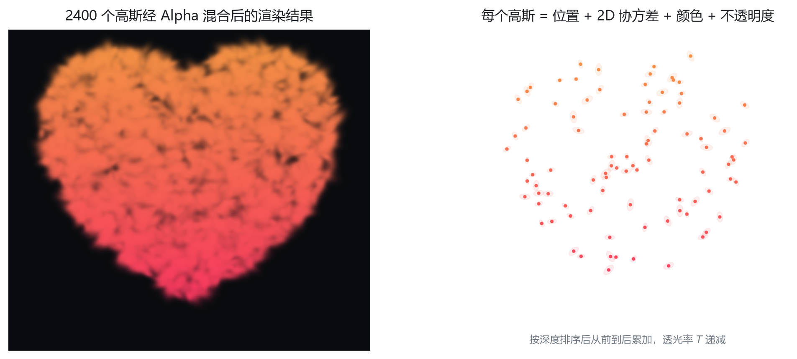
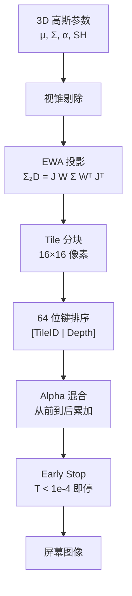

# 06 · 3D Gaussian Splatting：用几百万个椭球"拼"出一个世界

> **一句话**：3DGS 用几百万个可微的彩色半透明椭球显式表示场景，把它们投影"拍扁"到屏幕就是渲染。
>
> 这是整个学习路线的终点，也是课题组的方向。它之所以能取代 NeRF 成为实时重建的主流，原因只有两个字：**飞快**。

| 项目 | 内容 |
| :--- | :--- |
| 学习时间 | 2026.10.30 – 11.01 |
| 关键词 | 显式表征 / 协方差矩阵 / 四元数 / 球谐函数 / EWA 投影 / Alpha 混合 / 瓦片光栅化 / 密度控制 |
| 代码 | [`code/06_3dgs/`](../code/06_3dgs) |
| 产出 | 参数结构、单高斯可微拟合、2D 泼溅渲染、球谐变色、瓦片排序、密度控制决策 |

---

## 1. 为什么 NeRF 慢

| | NeRF（隐式） | 3DGS（显式） |
| :--- | :--- | :--- |
| 场景存哪 | 一个 MLP 的权重里 | 几百万个高斯的参数数组里 |
| 查询方式 | 输入 $(x,y,z,\theta,\phi)$，网络吐颜色 + 密度 | 直接读数组 |
| 渲染 | 每条光线采 100–200 个点，每点过一次 MLP | 高斯投影 + 光栅化，GPU 原生并行 |
| 1080P 一帧 | 网络调用**几亿次** | 一次前向光栅化 |
| 速度 | 几帧 / 秒 | **100+ FPS** |

> 渲染 200 万像素 × 每条光线 150 个采样点 = 3 亿次 MLP 调用。这就是 NeRF 无法用于 VR / 游戏的根因。

---

## 2. 一个高斯由什么构成



**3D 高斯 = 位置 + 形状姿态 + 不透明度 + 视角相关颜色**，共 11 个几何参数 + 48 个球谐系数。

| 属性 | 符号 | 维度 | 作用 |
| :--- | :--- | :-: | :--- |
| 中心位置 | $\mu$ | 3 | 椭球在世界坐标的哪里 |
| 缩放尺度 | $s$ | 3 | 三个轴向的半径（存对数，保证为正） |
| 旋转四元数 | $q$ | 4 | 椭球朝向（保证协方差半正定） |
| 不透明度 | $\alpha$ | 1 | 透光程度（sigmoid 映射到 0–1） |
| 球谐系数 | SH | 48 | 视角相关颜色（16 基函数 × RGB） |

### 2.1 协方差矩阵：形状与姿态的统一表达

$$
\Sigma = R\,S\,S^\top R^\top
$$

| 符号 | 含义 |
| :--- | :--- |
| $S = \text{diag}(s_x, s_y, s_z)$ | 三个轴的长度 |
| $R$ | 由单位四元数构造的旋转矩阵 |

为什么要拆成 $R$ 和 $S$？因为优化器需要**无约束**地更新参数：直接优化协方差矩阵无法保证它始终半正定，而"缩放取 exp 保证正 + 四元数归一化保证是旋转"天然满足约束。

> 记录里的总结很到位：**中心 $\mu$ 决定摆在哪，协方差 $\Sigma$ 决定体型和姿势。**

### 2.2 球谐函数：让颜色随视角变化

现实物体有高光：金属、水面从正面看和侧面看颜色不同。只存一个 RGB 无法表达。

球谐函数是"定义在球面上的傅里叶级数"：用一组基函数加权求和，拟合任意方向的颜色分布。

| 阶数 | 基函数个数 | 几何形态 | 物理含义 |
| :-: | :-: | :--- | :--- |
| 0 阶 | 1 | 均匀圆球 | 基础固有色（漫反射） |
| 1 阶 | 3 | 哑铃状 | 上下左右前后的粗略明暗 |
| 2 阶 | 5 | 四叶草 | 更细的过渡光 |
| 3 阶 | 7 | 多瓣花瓣 | 锐利的镜面高光 |

前 4 阶共 $1+3+5+7 = 16$ 个基函数，RGB 三个通道各一套系数：

$$
16 \times 3 = 48
$$

> 一个高斯的几何参数只有 11 个，但"变色外衣"要 48 个数字。所以 3DGS 的 `.ply` 文件动辄几百 MB——**绝大部分体积都是球谐系数**。

---

## 3. 渲染管线：从 3D 椭球到屏幕像素



### 3.1 EWA 投影：3D 协方差怎么"拍扁"成 2D

$$
\Sigma_{2D} = J\,W\,\Sigma_{3D}\,W^\top J^\top
$$

| 符号 | 含义 |
| :--- | :--- |
| $W$ | 视角变换矩阵（世界 → 相机） |
| $J$ | 透视投影的雅可比矩阵（处理"近大远小"） |
| $\Sigma_{2D}$ | 屏幕空间的 2×2 协方差 |

它决定这个椭圆在屏幕上**多宽、多长、倾斜多少度**。

**为什么需要低通滤波？** 远处的椭球投影后可能不到 1 个像素，直接采样会产生走样（锯齿、闪烁）。EWA 的做法是给 2D 协方差的对角线加一个下限（如 0.3 像素），相当于"强制加一层毛玻璃"，保证任意距离都平滑。

### 3.2 Alpha 混合：像素颜色怎么来

```text
C = Σᵢ cᵢ · αᵢ · Tᵢ
Tᵢ = Πⱼ<ᵢ (1 − αⱼ)      # 透光率，越靠前越小
```

- 显卡把覆盖该像素的高斯按**深度从前到后排序**；
- 每个高斯贡献 $c_i \alpha_i T_i$；
- 当累积透光率 $T < 10^{-4}$（说明已被实体完全挡住），**立即停止**（Early Stop）。

> 这就是比 NeRF 快上千倍的关键：**用光栅化硬件代替神经网络推理**。

### 3.3 Tile-Based：把屏幕切成小块并行

| 技巧 | 做法 | 收益 |
| :--- | :--- | :--- |
| 瓦片切分 | 屏幕切成 16×16 的 Tile，每个高斯只登记自己覆盖的 Tile | 计算范围缩小上百倍 |
| 64 位键排序 | 高 32 位存 Tile ID，低 32 位存深度，用 CUB Radix Sort 全局排序 | 同 Tile 聚在一起，Tile 内按深度有序 |
| 共享内存 | 一个线程块负责一个 Tile，参数先拉进 Shared Memory | 避免重复读显存 |
| Early Stop | 累积不透明度饱和后直接 break | 跳过大量被遮挡的无效计算 |

---

## 4. 自适应密度控制：哪里缺补哪里

固定数量的高斯无法同时表达细腻的杯把和大面积的白墙。3DGS 在训练中动态增删：

```text
每 100 步执行一次"体检"：

  ┌─ 屏幕空间位置梯度 > 阈值（0.0002）？
  │     否 → 不动
  │     是 → 看尺度（Scale）
  │           ├─ 尺度小 → 【克隆 Clone】：原地复制 + 沿梯度微移
  │           └─ 尺度大 → 【分裂 Split】：删除原高斯，拆成两个，尺度 ÷ 1.6
  │
  └─ 不透明度 < 阈值（≈0.005）→ 【修剪 Prune】直接删除
```

| 操作 | 触发条件 | 动作 | 解决什么问题 |
| :--- | :--- | :--- | :--- |
| Clone | 梯度大、尺度小 | 复制一个，朝梯度方向偏移 | 细电线、头发等微小结构表达不足 |
| Split | 梯度大、尺度大 | 一分为二，尺寸缩小 | 大椭球罩住复杂区域，糊成一片 |
| Prune | 不透明度极低 | 物理删除 | 空气中的"幽灵点"占显存 |

> 训练过程中高斯数量会从初始的几万个增长到几百万个——**场景的精度是"长"出来的**。

---

## 5. 真实工业流程


**初始高斯数量从哪来？** 单张照片无法确定，必须先用 COLMAP 做运动恢复结构（SfM），得到相机位姿与稀疏三维点云，再以这些点为中心初始化高斯。

---

## 6. 代码与张量对照

| 脚本 | 关键点 | 形状 | 观察 |
| :--- | :--- | :--- | :--- |
| [`gaussian_representation_demo.py`](../code/06_3dgs/gaussian_representation_demo.py) | `Σ = R S Sᵀ Rᵀ` | `[N,3,3]` | 四元数 → 旋转矩阵 |
| [`train_single_gaussian_toy.py`](../code/06_3dgs/train_single_gaussian_toy.py) | 直接对 $\mu$、颜色求导 | `[16,16,3]` | 无神经网络，参数即模型 |
| [`gaussian_splatting_2d_toy.py`](../code/06_3dgs/gaussian_splatting_2d_toy.py) | `J Σ Jᵀ` | `[3,3] → [2,2]` | 马氏距离衰减 + Alpha 混合 |
| [`spherical_harmonics_toy.py`](../code/06_3dgs/spherical_harmonics_toy.py) | 0/1 阶 SH | 颜色 `[3]` | 同一高斯不同视角变色 |
| [`tile_sort_rasterization_toy.py`](../code/06_3dgs/tile_sort_rasterization_toy.py) | `(tile_id, depth)` 排序 | 队列 | 同 Tile 聚集、按深度有序 |
| [`adaptive_density_control_toy.py`](../code/06_3dgs/adaptive_density_control_toy.py) | Clone / Split / Prune | 点数 3 → 4 | 决策规则演示 |

---

## 7. 踩坑记录

| 现象 | 原因 | 修法 |
| :--- | :--- | :--- |
| 渲染出现锯齿闪烁 | 远处高斯小于 1 像素 | 给 2D 协方差加低通下限 |
| 颜色随视角乱跳 | 视线方向未归一化 | `dir = (cam - μ).normalize()` |
| 协方差矩阵非正定 | 直接优化矩阵元素 | 改用 $R S S^T R^T$ 参数化 |
| 高斯数量爆炸 | 只增不减 | 定期 Prune 低不透明度点 |
| 训练 loss 下降但画面糊 | 尺度阈值设置不当 | 按场景尺度调整阈值 |
| 官方代码编译失败 | 缺 CUDA 工具链 | 用 WSL2 + 对应 CUDA 版本 |

---

## 8. 自测：8 个问题

<details>
<summary>1. 3DGS 与 NeRF 最本质的区别？</summary>

表征方式：NeRF 是隐式（MLP 存场景），3DGS 是显式（高斯参数数组存场景）。由此带来渲染方式与速度的巨大差异。
</details>

<details>
<summary>2. 为什么协方差要写成 $R S S^\top R^\top$？</summary>

保证矩阵始终半正定（$S$ 为正对角、$R$ 为正交旋转），同时让优化器可以无约束地更新 $s$ 与 $q$。
</details>

<details>
<summary>3. 一个高斯有多少个球谐参数？为什么是 48？</summary>

16 个基函数 × RGB 3 通道 = 48。0–3 阶基函数个数为 1+3+5+7=16。
</details>

<details>
<summary>4. EWA 投影在算什么？</summary>

把 3D 协方差经视角变换 $W$ 与投影雅可比 $J$ 映射为 2D 屏幕协方差，得到椭圆在屏幕上的大小与朝向。
</details>

<details>
<summary>5. Alpha 混合为什么必须按深度排序？</summary>

不透明度合成不满足交换律，前面的高斯会遮挡后面的，顺序错了颜色就错了。3DGS 用 64 位键排序一次搞定"按 Tile 分组 + 组内按深度"。
</details>

<details>
<summary>6. 克隆与分裂的区别？</summary>

克隆针对"小尺度、大梯度"的细节区域，复制一个并偏移；分裂针对"大尺度、大梯度"的模糊区域，删掉原高斯换成两个更小的。
</details>

<details>
<summary>7. 为什么 3DGS 需要多视角照片？</summary>

单张图无法恢复三维结构；需要 SfM（COLMAP）从多视角图像中解算相机位姿与稀疏点云，作为高斯的初始位置。
</details>

<details>
<summary>8. 3DGS 的"可微"体现在哪？</summary>

从高斯参数 → 投影 → 排序 → Alpha 混合的整条渲染链路都可求导，因此可以用渲染图与真实照片的 L1/L2 损失直接反传，更新每个高斯的参数。
</details>

---

## 9. 延伸阅读

- Kerbl et al., *3D Gaussian Splatting for Real-Time Radiance Field Rendering* (SIGGRAPH 2023)
- Zwicker et al., *EWA Splatting* (2002) —— 投影公式的来源
- Mildenhall et al., *NeRF: Representing Scenes as Neural Radiance Fields for View Synthesis* (2020)
- Schönberger & Frahm, *COLMAP* (2016) —— SfM 工具链
