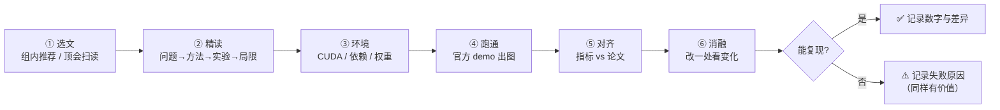

# 论文复现 · Paper Reproduction

> 从「跑通 Demo」到「复现论文」：这里记录组内方向（神经隐式场 / 3DGS / 点云重建）的精读笔记与 Baseline 复现过程。

| 项目 | 说明 |
| :--- | :--- |
| 目标 | 每篇论文产出一份**能讲给别人听**的精读笔记 + 一份**能跑出数字**的复现记录 |
| 范围 | SIGGRAPH / SIGGRAPH Asia / CVPR / ICCV / ECCV / PG 近 2–3 年 |
| 当前阶段 | 🏗 框架已搭好，等待第一批论文进入 |
| 关联 | 基础篇见 [`docs/06-3dgs.md`](../docs/06-3dgs.md)；工具链见 [`docs/07-git-workflow.md`](../docs/07-git-workflow.md) |

---

## 1. 工作流：一篇论文的六个阶段



**核心原则：复现失败也要完整记录。** 论文里没写的隐藏超参、数据预处理、评测协议，往往才是最有价值的信息。

---

## 2. 状态看板

> 每收录一篇论文，就在下表加一行；状态变更时同步更新。

| # | 论文 | 会议/年份 | 方向 | 精读 | 复现 | 笔记 |
| :-: | :--- | :--- | :--- | :-: | :-: | :-: |
| — | *（等待第一篇）* | — | — | — | — | — |

状态说明：`📋 待读` · `📖 精读中` · `🛠 复现中` · `✅ 已复现` · `⚠️ 复现受阻`

---

## 3. 目录规范

```text
paper-reproduction/
├── README.md                 # 本文件：流程、看板、规范
├── templates/
│   ├── paper-card.md         # 论文卡片（论文目录的 README）
│   ├── paper-note.md         # 精读笔记模板
│   └── repro-log.md          # 复现日志模板
├── checklists/
│   └── repro-checklist.md    # 复现前/中/后的自检清单
└── papers/
    ├── README.md             # 命名与目录约定
    └── 2023-Kerbl-3DGS/      # 示例命名：年份-一作-简称
        ├── README.md         # 论文卡片（元信息 + 三句话总结）
        ├── notes.md          # 精读笔记
        ├── repro.md          # 复现记录
        ├── assets/           # 架构图、结果对比图、训练曲线
        └── code/             # 复现用的脚本 / 配置（大仓库用 submodule 或只放 patch）
```

**命名**：`YYYY-FirstAuthor-ShortName`，例如 `2023-Kerbl-3DGS`、`2024-Wu-GaussianSplattingSLAM`。

---

## 4. 大文件策略

| 内容 | 是否入库 | 说明 |
| :--- | :--- | :--- |
| 精读笔记 / 复现报告（md） | ✅ | 核心资产 |
| 结果图、训练曲线（png） | ✅ | 单张 < 2 MB |
| 训练日志（.log） | ❌ | 只保留摘要到 `repro.md` |
| 数据集 | ❌ | 用脚本下载，`.gitignore` 已屏蔽 |
| 模型权重（.pth/.ply） | ❌ | 记录下载链接或训练命令 |
| 官方代码 | ❌ | 记录 commit hash + 复现补丁（patch） |

---

## 5. 笔记整理流程（给我看）

后续把材料发我时，按下面清单给，我可以直接整理成仓库里的标准格式：

1. **论文信息**：标题、作者、会议年份、论文链接、官方代码链接；
2. **精读笔记**：Word / Markdown / 截图都行（我会转成 `notes.md`）；
3. **复现记录**：环境版本、数据集、启动命令、训练时长、最终指标；
4. **对比数据**：论文数字 vs 我的数字（表格或截图）；
5. **踩坑**：报错原文、现象、解决方式；
6. **结果图**：渲染图、loss 曲线、消融表。

> 缺哪一项都没关系，我会按模板把空位标成 `TODO`，后续再补。
