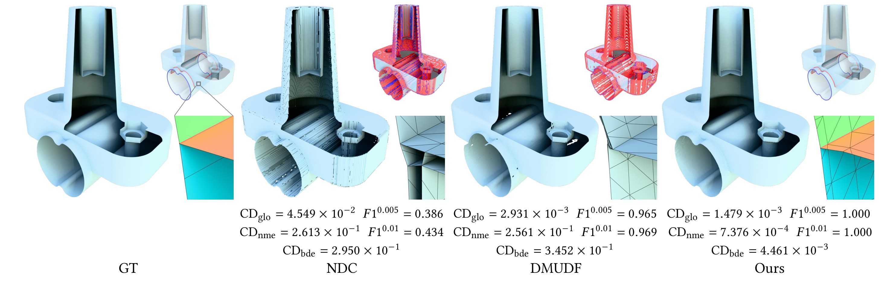

# DCx · Dual Contouring over Expanded Cubes

> 用「扩展立方体」把经典 Dual Contouring 推广到**无符号距离场（UDF）**，从神经 UDF 中提取出**单层、无自交、支持非流形**的零水平集网格。



> 图源：原论文 Fig. 1（CC BY 4.0）。红色为非流形边，蓝色为边界边；NDC 与 DMUDF 在非流形区域产生大量伪结构，DCx 的 F1 达到 1.000。

| 项目 | 内容 |
| :--- | :--- |
| 标题 | Dual Contouring over Expanded Cubes (DCx) for Zero-Level Set Extraction from Neural Unsigned Distance Functions |
| 作者 | Qingchao Bao, Xuhui Chen, Jingpeng Yin, Fei Hou, Wencheng Wang, Hong Qin, Ying He |
| 单位 | 中科院软件所 · 国科大 · 大连理工 · Stony Brook · NTU |
| 会议 | ACM SIGGRAPH 2026 / ACM TOG 45(4), Article 56 |
| DOI | [10.1145/3811388](https://doi.org/10.1145/3811388) |
| 代码 | [github.com/jjjkkyz/DCx](https://github.com/jjjkkyz/DCx) |
| 关键词 | dual contouring / unsigned distance function / non-manifold / neural representation |
| 我的状态 | 📖 精读中（代码已走读，环境待修复） |

---

## 三句话总结

1. **要解决什么**：UDF 没有符号，传统 MC / DC 靠"穿过表面时距离值变号"来找活动立方体，这个方法直接失效；现有做法（阈值、学习预测、双层网格）要么漏面、要么产生大量伪非流形。
2. **怎么做的**：把"找活动立方体"换成**优化问题**——从距离小于阈值的体素中心出发，沿梯度把点投影到零水平集，落在哪个体素里就激活哪个；再把面片生成从"逐边 4 立方体"换成**2×2×2 扩展立方体 + V2M 查找表**，用 17 类模板拼面。
3. **结果如何**：在 CAPUDF 学到的神经 UDF 上，$CD_{glo}=1.579\times10^{-3}$（优于 DCUDF 的 $1.640\times10^{-3}$），非流形边误差 $CD_{nme}=3.172\times10^{-3}$，比 DMUDF（$1.002\times10^{-1}$）低约 **30 倍**，且输出是单层无自交网格。

---

## 为什么值得读

- 它是**几何处理 + 神经隐式场**的交叉点：不训练网络，只改"从场里抽网格"这一步，却直接决定了重建质量的拓扑正确性。
- 方法**概念极简**：没有学习、没有大数据，两个改动就能讲清楚，适合作为进入"神经隐式几何"方向的第一个精读对象。
- 代码规模可控（C++ 核心约 1.5 万行 + Python 胶水），能完整走通"读论文 → 读代码 → 跑实验"的闭环。

## 两个核心贡献

| 贡献 | 替代了什么 | 解决的痛点 |
| :--- | :--- | :--- |
| **优化式活动立方体选择** | SDF 的符号变化检测 / UDF 的阈值判断 / 学习预测 | 近表面梯度噪声导致的漏检、误检 |
| **扩展立方体 + V2M 查找表** | 逐边连接 4 个相邻立方体 | UDF 下活动立方体分布稀疏不规则，传统连面会破洞或产生伪非流形 |

## 关键数字（速记）

| 指标 | DCx | 最强基线 | 说明 |
| :--- | ---: | ---: | :--- |
| $CD_{glo}$（神经 UDF） | $1.579\times10^{-3}$ | DCUDF $1.640\times10^{-3}$ | 全局几何精度 |
| $CD_{nme}$（非流形边） | $3.172\times10^{-3}$ | DMUDF $1.002\times10^{-1}$ | 非流形区域质量，差 30 倍 |
| $CD_{bde}$（边界边） | $6.784\times10^{-3}$ | MeshUDF $6.133\times10^{-2}$ | 开放曲面边界 |
| 网格层数 / 自交 | 单层 / 无 | DCUDF 双层、DMUDF 多层 | 拓扑正确性 |

---

## 我的复现状态

| 阶段 | 状态 | 说明 |
| :--- | :-: | :--- |
| 论文精读 | ✅ | 见 [`notes.md`](notes.md) |
| 术语扫盲 | ✅ | 见 [`glossary.md`](glossary.md)（30+ 词条） |
| 代码走读 | 🟡 | 见 [`code-map.md`](code-map.md)，主链路已梳理 |
| 环境配置 | ⚠️ | 当前机器**无 NVIDIA GPU**，`torch` 为 CPU 版，`cubvh`/`dcx_pkg` 未安装 → 跑不起来，详见 [`repro.md`](repro.md) |
| 跑通 Demo | ⬜ | 需切换到云 GPU（AutoDL）后执行 |
| 指标对齐 | ⬜ | 待跑通后填写 |

> **一句话结论**：这篇论文的方法适合在**有 NVIDIA GPU 的机器/云服务器**上复现；当前笔记本只能完成读论文与读代码，这一步的记录同样是复现工作的一部分。

---

## 目录

| 文件 | 内容 |
| :--- | :--- |
| [`notes.md`](notes.md) | 精读笔记：问题、方法逐步拆解、实验、批判与延伸 |
| [`glossary.md`](glossary.md) | 专业名词表：UDF、QEF、活动立方体、流形、Chamfer 距离…… |
| [`code-map.md`](code-map.md) | 代码地图 + 调用链 + **7 天学习计划** |
| [`repro.md`](repro.md) | 复现记录：环境体检、报错、云 GPU 操作清单、指标对照 |
| [`study-log.md`](study-log.md) | 学习日志：每天做了什么、卡在哪、想通了什么 |
| [`assets/`](assets) | 论文插图（CC BY 4.0，已标注来源） |

## 引用

```bibtex
@article{10.1145/3811388,
  author    = {Bao, Qingchao and Chen, Xuhui and Yin, Jingpeng and Hou, Fei
               and Wang, Wencheng and Qin, Hong and He, Ying},
  title     = {Dual Contouring over Expanded Cubes (DCx) for Zero-Level Set
               Extraction from Neural Unsigned Distance Functions},
  journal   = {ACM Trans. Graph.},
  volume    = {45}, number = {4}, articleno = {56},
  year      = {2026}, month = jul,
  doi       = {10.1145/3811388}
}
```
