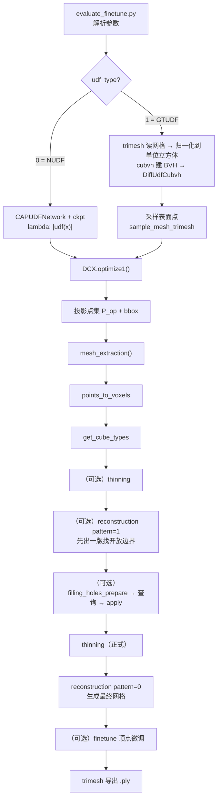

# 代码地图 · DCx

> 目标：**不逐行读 1.5 万行 C++**，而是先建立"输入 → 输出"的主干，再按需下钻。
> 仓库位置：`E:\DCx-main`（GitHub 下载的 zip 解压版，非 git clone）。

---

## 1. 目录总览

```text
DCx-main/
├── evaluate_finetune.py          # ★ 唯一入口：抽网格 + 微调
├── confs/test.conf               # ★ 所有超参都在这里
├── DCX/                          # 核心算法
│   ├── DCX_main.cpp              #   pybind11 绑定层（Python 能调的 7 个函数）
│   ├── points_to_voxels.cpp      #   点 → 体素（哈希 + 排序）
│   ├── thinning_and_reconstruction_with_3_special_classes.cpp   # ★ 细化 + 重建（57 KB，最核心）
│   ├── V2M_tables_with_3_special_classes.hpp                    # ★ V2M 查找表（51 KB，纯数据）
│   ├── upsampling_speedup_...py  # ★ 投影优化 + 补采样 + 微调（Python，900+ 行）
│   ├── cxh_GTUDF.py              #   用 cubvh 算精确 UDF 的可微封装
│   ├── VectorAdam.py             #   投影用的优化器
│   └── CAPUDFvsGTUDF*.py         #   评测脚本（算 Chamfer 等）
├── CAPUDF/                       # 神经 UDF 训练（CAP-UDF 精简版）
│   ├── run.py                    #   训练入口
│   ├── models/fields.py          #   CAPUDFNetwork 定义
│   ├── models/dataset.py         #   点云数据集
│   └── extensions/chamfer_dist/  #   Chamfer 距离 CUDA 扩展
├── assets/                       # README 插图
└── data/ ckpt/ result/           # 运行后生成（需自己建）
```

**先记住三个文件**：入口 `evaluate_finetune.py`、配置 `confs/test.conf`、优化器 `DCX/upsampling_...py`。其余都是它们调用的下游。

---

## 2. 主调用链



| 阶段 | 代码位置 | 输入 → 输出 |
| :--- | :--- | :--- |
| 读数据 | `evaluate_finetune.py` `test()` | 网格 `.ply` → 归一化网格 / 或 ckpt → UDF 函数 |
| 采样 + 投影 | `DCX.optimize1()` | 网格上的点 → $P_{op}$（贴到表面的点集）+ bbox |
| 点 → 体素 | `dcx_pkg.points_to_voxels` | `[N,3]` → `voxel_ids [M]`、`voxel_points [M,3]`、`orders [2]` |
| 体素 → 立方体类型 | `dcx_pkg.get_cube_types` | 体素集合 → `cube_ids`、`cube_types`（17 类编码） |
| 细化 | `dcx_pkg.thinning` | 删掉错误激活的体素 |
| 重建 | `dcx_pkg.reconstruction` | `vertices [V,3]`、`faces [F,3]` |
| 补采样 | `filling_holes_prepare / apply` | 找出开放边界附近的候选点，筛选后加回体素集 |
| 微调 | `DCX.finetune()` | 用 Laplacian 等约束优化顶点位置 |

> `pattern=1` 与 `pattern=0` 的区别（我的推断，待跑通验证）：前者只输出"边界面片/边界的体素 id"（`margin_voxel_ids`），用于定位洞；后者输出完整网格。

---

## 3. 每个文件干什么（按重要性）

| 文件 | 规模 | 作用 | 要不要读 |
| :--- | :-: | :--- | :-: |
| `evaluate_finetune.py` | 260 行 | 入口：参数、两种 UDF 模式、调用 mesh_extraction、导出 | ★★★ 必读 |
| `confs/test.conf` | 76 行 | 分辨率、阈值、迭代次数、学习率、网络结构 | ★★★ 必读 |
| `DCX/upsampling_...py` | 990 行 | `DCX` 类：`optimize1` 投影、`filter_query_points_for_filling_holes` 补采样筛选、`finetune` 微调 | ★★★ 读前 600 行 |
| `DCX/DCX_main.cpp` | 470 行 | pybind11 绑定 + 参数校验 + 序列化 | ★★ 读函数签名即可 |
| `DCX/points_to_voxels.cpp` | 90 行 | 点落入哪个体素（哈希表 + 排序） | ★★ 很短，可读 |
| `DCX/thinning_and_reconstruction_...cpp` | 1400+ 行 | 细化 + V2M 查表 + 连面 | ★ 先看函数名与 Case 8 |
| `DCX/V2M_tables_with_3_special_classes.hpp` | 1500+ 行 | 17 类模板数据 | ☆ 当数据查，不逐行读 |
| `DCX/cxh_GTUDF.py` | 130 行 | 自定义 autograd：距离 + 梯度（梯度 = 指向最近点的单位向量） | ★★ 有助理解 UDF 梯度 |
| `CAPUDF/run.py` | 230 行 | 训练 NUDF（复现 NUDF 模式才需要） | ★ 可选 |

---

## 4. 从哪开始读（5 步法）

1. **先读 `evaluate_finetune.py` 的 `__main__` 和 `test()`**（约 100 行）：搞清楚"两种模式"和"一条流水线"。
2. **读 `confs/test.conf`**：把 `resolution / threshold / iter_max / learning_rate / max_batch` 和论文里的 $\delta_0,\delta_1,n$ 对上。
3. **读 `DCX.optimize1()` 的前 120 行**：候选点筛选 → 求梯度 → 沿梯度线搜索。对照论文公式 (1)。
4. **读 `mesh_extraction()`**：7 个 `dcx_pkg.*` 调用的顺序，就是论文第 4–5 节的顺序。
5. **最后看 C++ 的 `reconstruction`**：只需要看懂"输入 cube_types，查表，输出 vertices/faces"，不必逐行读 17 类模板。

> 读代码时**始终带着这个问题**：这一步对应论文哪一节、哪个公式、哪张图？

---

## 5. 7 天学习计划（可直接照做）

| 天 | 任务 | 产出 | 验收标准 |
| :-: | :--- | :--- | :--- |
| D1 | 读论文 §1–2 + 本目录 `glossary.md`；看 Fig. 2/4/5 | 用自己的话画出 pipeline（纸笔即可） | 能解释"为什么 UDF 没有活动立方体" |
| D2 | 读 §3–4：投影 + 细化 | 手推公式 (1)，写出 $s_i$ 的更新式 | 能解释"为什么只沿梯度方向走" |
| D3 | 读 §5 + Table 2/3/4 | 整理 17 类模板的分组表 | 能说出 Group 2.2 为什么要 anchor |
| D4 | 环境：云 GPU 上装好（见 `repro.md`） | `import dcx_pkg` 成功、`cubvh` 可用 | 能跑 `nvidia-smi` 与 `torch.cuda.is_available()` |
| D5 | 跑 GTUDF 模式：一个球 / 一个 T 形件 | 输出 `.ply`，用 MeshLab/trimesh 打开 | 网格闭合、无破洞 |
| D6 | 加打印：各阶段点数、体素数、cube_types 分布 | 一张"数据规模变化"表 | 能对上论文 Table 6 的量级 |
| D7 | 复盘：写 `study-log.md` + 更新 `repro.md` | 一页复现小结（含失败点） | 能讲清"哪一步最耗时、为什么" |

> 如果时间紧，D1–D3 可以先做，D4–D6 放到有 GPU 的时候。

---

## 6. 跑之前必须知道的参数

| 参数 | 位置 | 默认 | 含义 |
| :--- | :--- | :--- | :--- |
| `evaluate.resolution` | conf | 256 | 体素分辨率 $n$；决定精度与显存 |
| `evaluate.threshold` | conf | 0.005 | 距离阈值（对应 $\delta_0$ 量级） |
| `evaluate.iter_max` | conf | 250 | 投影迭代次数（论文写 200） |
| `evaluate.learning_rate` | conf | 0.05 | 投影学习率（论文写 0.01） |
| `evaluate.max_batch` | conf | 400000 | 一次查询多少个点，显存不够就调小 |
| `--num_points` | CLI | 2e8 | GTUDF 模式从网格采多少个点（很大！） |
| `--thinning` | CLI | off | 建议开 |
| `--supplementary_sampling` | CLI | off | NUDF 模式建议开 |
| `--postprocessing` | CLI | off | 建议开 |
| `--finetune` | CLI | off | 用 DCUDF 的优化再修一遍顶点 |

> ⚠️ `--num_points 200000000`（2 亿）非常吃内存。第一次跑建议改成 `2000000`（200 万）先验证链路。

---

## 7. 调试技巧

| 场景 | 做法 |
| :--- | :--- |
| 想快速验证链路 | `resolution=64`、`num_points=500000`、只开 `--thinning` |
| 想知道每步耗时 | 在 `mesh_extraction()` 里每个 `dcx_pkg.*` 前后打时间戳 |
| 想可视化中间结果 | 把 `voxel_points` 存成 `.ply`（`trimesh.PointCloud`）用 MeshLab 看 |
| 网格破洞 | 先关掉 `--postprocessing` 看是不是后处理裁过头；再看 `--supplementary_sampling` |
| 非流形过多 | 检查 `--thinning` 是否开启；降低分辨率看是否与曲率歧义有关 |
| 显存不足 | 调小 `max_batch`；调小 `resolution` |
| 结果全是空的 | 检查 bbox：`evaluate_finetune.py` 把模型归一化到 $[-0.5,0.5]^3$，如果你的数据不在这个范围就会全空 |

---

## 8. 读代码时记下的问题（待验证）

- [ ] `optimize1()` 里 `bound = 10/res + 0.5`、`dist_upper_bound = 3/res`，与论文的 $\delta_0=1.5/n$ 是什么关系？
- [ ] `orders` 这个 `[2]` 的数组到底存了什么（代码里 `initialize_thinning_context(orders, res)`）？
- [ ] `reconstruction(pattern=1)` 返回的 `margin_voxel_ids` 是如何定义的？
- [ ] `finetune()` 里 Laplacian 项的权重与 DCUDF 原版是否一致？
- [ ] `CAPUDFvsGTUDF.py` 与 `CAPUDFvsGTUDF_global.py` 的指标实现是否与论文 Table 5 一致？
