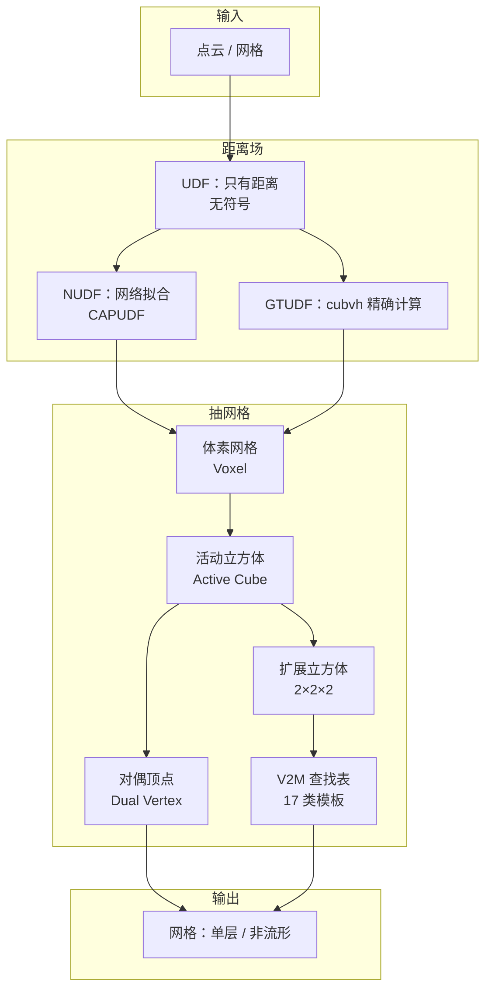

# 术语表 · DCx

> 读论文/读代码时遇到不认识的词就来这里查。
> 每条格式：**一句话定义 → 在这篇论文里具体指什么 → 一个类比**。

---

## A. 距离场

### SDF · Signed Distance Function（有符号距离场）

给空间中每一点返回"到最近表面的距离"，并带正负号（外部为正、内部为负）。

- **在本文**：作为对照出现。SDF 能表示封闭曲面，但无法表示开放面/非流形。
- **类比**：一张"海拔图"，海平面以上为正、以下为负，0 等高线就是海岸线。

### UDF · Unsigned Distance Function（无符号距离场）

只保留距离的绝对值，丢掉正负号。

- **在本文**：主角。因为没有符号，传统抽网格方法失效，这正是 DCx 要解决的问题。
- **代价**：无法区分"物体内部"和"物体外部"，所以不能直接用 MC/DC。

### NUDF · Neural UDF（神经无符号距离场）

用一个神经网络（MLP）拟合的 UDF：输入三维坐标，输出距离值。

- **在本文**：用 CAPUDF 从点云训练得到，是 DCx 的主要输入之一。
- **特点**：表达能力强，但在表面附近不可微、梯度有噪声。

### GTUDF · Ground-Truth UDF（真值无符号距离场）

用几何计算（而不是学习）得到的精确 UDF。

- **在本文**：用 `cubvh` 库对输入网格精确计算点到三角面片的距离，用于"排除网络误差、只看算法本身"的实验。
- **意义**：如果连 GTUDF 都重建不好，说明问题在抽网格算法；如果 GTUDF 好、NUDF 差，说明瓶颈在学习。

### Zero-level set（零水平集）

函数值等于 0 的点的集合，也就是"表面"。

- **在本文**：`u(x) = 0` 的点集，即要提取的网格。
- **注意**：UDF 的零水平集**不是**符号变化的位置，只能靠"距离最小"来逼近。

### Medial axis（中轴）

到表面至少有两个最近点的那些点构成的集合（"骨架"）。

- **在本文**：UDF 在中轴上不可微，是梯度误差的第二大来源。
- **类比**：一片森林里"离两棵树一样近"的所有位置连成的线。

---

## B. 拓扑

### Manifold（流形）

局部看起来像平面（二维）或直线（一维）的曲面：每个点附近都能摊平。

- **在本文**：普通物体表面是流形；"三条面交于一条边"就不是。

### Non-manifold（非流形）

不满足流形条件的结构：一条边被 3 个以上面共享，或两个面只在一个点相接。

- **在本文**：DCx 的核心目标就是**正确重建非流形**（比如 T 形接头、内部隔板）。
- **为什么难**：大多数网格算法默认输入是流形，遇到非流形会"劈开"或"糊住"。

### Watertight（水密 / 封闭）

曲面没有边界、完全包住一个体积，像气球一样。

- **在本文**：SDF 只能表示水密的；UDF 可以表示不水密的（有开口的）。

### Open surface / Boundary edge（开放曲面 / 边界边）

曲面有"边缘"（比如一张纸的四条边）。只被一个面共享的边叫边界边。

- **在本文**：蓝色高亮的就是边界边；$CD_{bde}$ 专门评价它。

### Self-intersection（自交）

网格自己穿过自己，通常出现在双层网格（double layer）里。

- **在本文**：DCUDF 输出双层，两层之间会自交；DCx 输出单层，无自交。

### Single-layer / Double-layer（单层 / 双层）

一个薄壁被表示成"一层"还是"内外两层壳"。

- **在本文**：双层会浪费存储、让编辑/碰撞检测变复杂；DCx 坚持单层。

---

## C. 网格提取

### Voxel（体素）

三维空间里的小立方格，相当于三维像素。

- **在本文**：分辨率 $n=256$ 表示每个方向切 256 份，共 $256^3 \approx 1678$ 万个体素。

### Active cube（活动立方体）

被认为"包含表面"的体素。

- **在本文**：只要有一个投影点落在里面，就是活动的。
- **为什么关键**：活动立方体的判定错一个，网格就破一个洞或多一块面。

### Dual vertex（对偶顶点）

每个活动立方体内部放一个顶点，用它代表这个立方体与表面的交点。

- **在本文**：顶点位置 = 投影点的平均（不是 QEF 解）。

### Hermite data（埃尔米特数据）

交点位置 + 该点法向。

- **在本文**：DC 的原始输入；UDF 只能提供距离和梯度，法向不可靠，所以 DCx 绕开了 QEF。

### QEF · Quadratic Error Function（二次误差函数）

把所有"交点到切平面"的平方距离加起来，最小化它来求顶点位置。

- **在本文**：被**弃用**。因为 UDF 的交点和法向都不可靠，QEF 会不稳定。
- **代价**：失去 DC 原本的"保尖锐特征"能力。

### Marching Cubes（MC，移动立方体）

沿体素边找符号变化点，按查找表连三角形。

- **在本文**：作为基线（MeshUDF 用伪符号 + MC），无法处理非流形。

### Dual Contouring（DC，对偶轮廓）

每个活动立方体放一个顶点，再连接相邻立方体的顶点成面。

- **在本文**：DCx 的出发点。DC 天然适合非流形（一个顶点可以连多个面）。

### Lookup table（查找表 / LUT）

预先枚举所有局部配置，把"配置 → 网格连接方式"写成表，运行时直接查。

- **在本文**：V2M 表，17 类模板，是 DCx 的核心工程产物。

### Expanded cube（扩展立方体）

$2\times2\times2$ 共 8 个体素组成的块。

- **在本文**：连面的基本单位。相邻扩展立方体**重叠 4 个体素**，所以信息是连续的。

### V2M · Voxel-to-Mesh（体素到网格）

把"8 个体素的激活模式"映射到"对偶立方体里怎么连面"的查找表。

- **在本文**：$2^8=256$ 种模式 → 去等价后 17 类。

### Thinning（细化 / 抽稀）

删掉被错误激活的体素，保证表面是"单层"的。

- **在本文**：两个条件，分别处理"破坏 Case 8 结构"和"产生多余非流形"的体素。

### Supplementary sampling（补采样）

在网格开放边界附近补采点，填补漏掉的活动立方体。

- **在本文**：先出初始网格 → 找边界 → 在邻域随机采样 → 距离小于 $\delta_1$ 就加入。

---

## D. 优化

### Gradient descent（梯度下降）

沿着梯度的反方向走，让函数值变小。

- **在本文**：把点沿 $\nabla u$ 推到 $u=0$ 的地方。

### Line search（线搜索）

固定方向、只优化"走多远"这一个标量。

- **在本文**：公式 (1)，只优化 $s_i$，方向固定为原始梯度——这是稳定性的来源。

### VectorAdam

一种对旋转等变的 Adam 变体，适合几何优化。

- **在本文**：替代 SGD 做投影，减少局部噪声导致的假极小值。

### Projection（投影）

把空间中的点移动到最近的表面上。

- **在本文**：整个 pipeline 的第一步，也是耗时最大的一步（占总时间约 60%）。

---

## E. 评价指标

### Chamfer Distance（CD，倒角距离）

两个点集互相"找最近邻"的平均距离，越小越接近。

$$
CD(X,Y)=\frac{1}{|X|}\sum_{x\in X}\min_{y\in Y}\|x-y\|_2+\frac{1}{|Y|}\sum_{y\in Y}\min_{x\in X}\|y-x\|_2
$$

- **在本文**：三个变体——
  - $CD_{glo}$：整个表面均匀采样；
  - $CD_{nme}$：只在**非流形边**上采样（评价拓扑）；
  - $CD_{bde}$：只在**边界边**上采样（评价开放边界）。

### F-score

在某个距离阈值内，precision 与 recall 的调和平均。

- **在本文**：Fig. 1 里用 $F1^{0.005}$、$F1^{0.01}$ 辅助展示，DCx 达到 1.000。

---

## F. 工程

### CUDA

NVIDIA 的 GPU 并行计算平台。本文的 UDF 查询、投影都在 GPU 上跑。

- **注意**：没有 NVIDIA 显卡就跑不了（这是当前环境的核心障碍）。

### pybind11

把 C++ 代码包装成 Python 模块的工具。

- **在本文**：`DCX_main.cpp` 编译成 `dcx_pkg`，Python 里 `import dcx_pkg` 调 C++ 函数。

### cubvh

一个基于 CUDA 的 BVH 库，能快速算点到三角网格的精确距离与梯度。

- **在本文**：生成 GTUDF；也是 `cubvh.cuBVH` 的来源。

### CAPUDF

一种从点云学习 UDF 的方法（CVPR 2022），本文用它生成神经 UDF。

- **在本文**：`CAPUDF/` 目录就是它的精简版，负责训练出 `.pth` 权重。

---

## 概念地图

---

## 读论文时的查词顺序建议

1. 先搞懂 **SDF / UDF / 零水平集**（不懂这三个，后面全是天书）；
2. 再搞懂 **体素 / 活动立方体 / 对偶顶点**（这是"抽网格"的骨架）；
3. 然后 **QEF / MC / DC**（理解传统方法为什么失效）；
4. 最后 **扩展立方体 / V2M / 非流形**（本文的创新点）。
