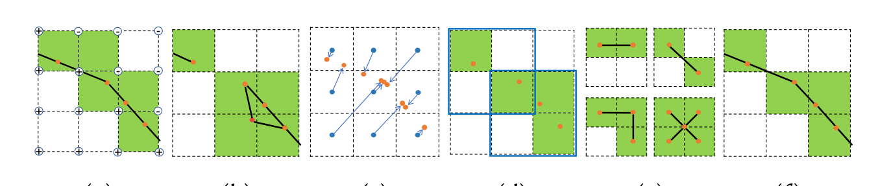
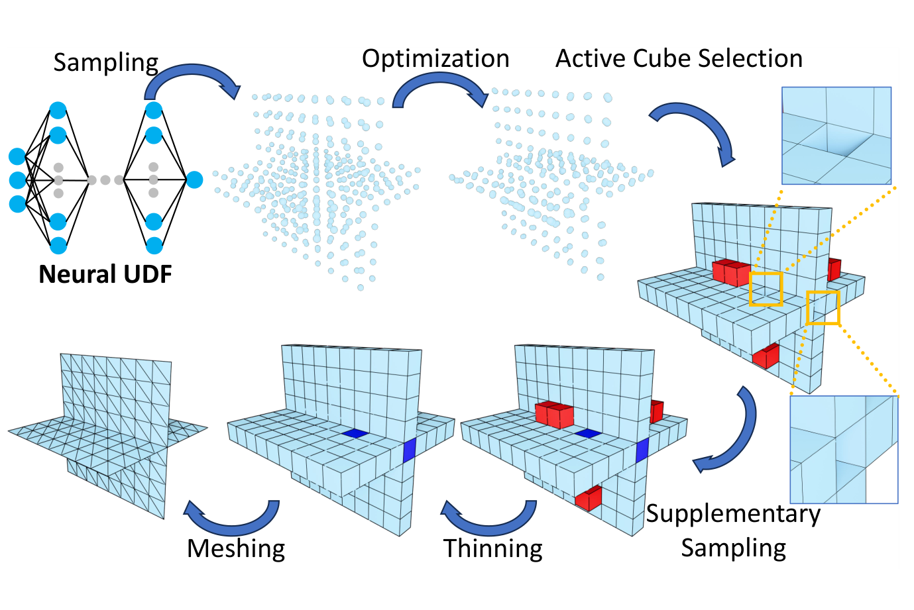
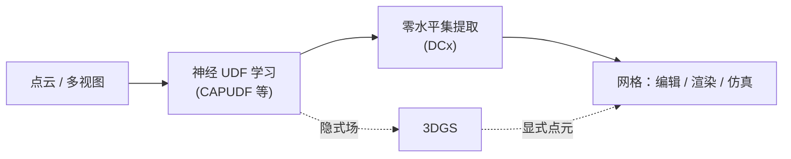

# 精读笔记 · DCx

> 阅读时间：2026.11.02 起 · 状态：第一遍精读完成，代码走读中
> 原则：每个公式都配一句人话；每个"为什么"都要能回答"不这么做会怎样"。

---

## 0. 读前背景

- **我为什么会读这篇**：课题组方向是神经隐式几何 / 3DGS / 点云重建，这篇是组内 2026 年 SIGGRAPH 的工作，且是"从场里抽网格"这一环节的最新进展。
- **读之前我以为它会怎么做**：以为是用神经网络去学"哪些立方体是活动的"（类似 NDC）。
- **最反直觉的一点**：它**完全没有用学习**，而是把一个离散判定问题（活动立方体）换成了一个连续优化问题（把点投影到零水平集）。"用优化代替判定"是全文的灵魂。

---

## 1. 问题：为什么 UDF 难抽网格

### 1.1 SDF 与 UDF 的区别

| | SDF（有符号） | UDF（无符号） |
| :--- | :--- | :--- |
| 定义 | 到表面的距离 + 在内部/外部的符号 | 只保留到表面的距离 |
| 能表示 | 封闭（watertight）曲面 | 开放曲面、非流形、带内部结构 |
| 抽网格 | 沿边找"符号翻转"即可定位表面 | **没有符号翻转**，无法判断哪条边穿过了表面 |

传统 Marching Cubes（MC）与 Dual Contouring（DC）都依赖"符号变化"来判定活动立方体。UDF 把这个信号拿掉了，所以两者都不能直接用。

### 1.2 三个具体的难点

论文用 CAPUDF 学到的 T 形接头 UDF 做了误差可视化（Fig. 3），结论有三条：

1. **离表面越远，距离误差越大**——训练监督集中在表面附近，远处泛化差；
2. **非流形结构附近误差显著更大**——尖锐交汇、边界、局部拓扑歧义让网络难以拟合；
3. **零水平集与中轴（medial axis）上梯度误差大**——这两个位置 UDF 本身不可微，而网络是光滑的。

> 人话：**UDF 在最需要精确的地方（表面）恰恰最不可靠**。这直接击穿了 QEF（二次误差函数）求顶点位置的前提——QEF 需要可靠的交点与法向。

### 1.3 已有方法卡在哪

| 方法 | 思路 | 问题 |
| :--- | :--- | :--- |
| MeshUDF / CAPUDF | 用梯度给角点"伪符号"，再跑 MC | 非流形处伪符号失效，破洞、断边 |
| DMUDF | 阈值选活动立方体 + 八叉树 + QEF | 远处 UDF 误差大 → 八叉树建错 → 缺结构；多层网格 |
| NDC | 训练网络预测"表面穿过的边" | 需要监督；边界擦过时误判 |
| DCUDF | 提取 $r$-等值面（双层）再收缩 | 双层网格、有自交；非流形无法分成两个同余分量 |
| MIND / MI | 用材料界面表示非流形 | 难以直接从点云推断；不支持不可定向曲面 |

**共同病根**：都在"用一个局部判据去猜哪里是表面"，而没有真正把点**投到**表面上。

> 图源：原论文 Fig. 4（CC BY 4.0）。六个子图从左到右：(a) 标准 DC 用符号变化找活动立方体（绿）并解 QEF 定顶点（橙）；(b) UDF 下传统连面出现破洞/冗余；(c) DCx 先从距离小于阈值的立方体出发；(d) 把中心点（蓝）投影到零水平集，点落在哪个立方体就激活哪个；(e) 用 V2M 查找表生成面片；(f) 最终网格。

---

## 2. 核心思想：两个改动

> 图源：原论文 Fig. 5（CC BY 4.0）。流程：神经 UDF → 采样 → 优化投影 → 活动立方体选择 →（补采样 / 细化）→ V2M 查表生成网格。

| # | 改动 | 一句话 |
| :-: | :--- | :--- |
| ① | **优化式活动立方体选择** | 不再"判断"哪个体素含表面，而是把体素中心**投影**到表面上，投影点落在哪个体素，哪个体素就激活 |
| ② | **扩展立方体 + V2M 查找表** | 不再"逐边连 4 个立方体"，而是以 $2\times2\times2$ 体素块为单位，用预定义模板拼面 |

### 2.1 为什么"投影"能解决判定问题

UDF 的一个关键性质：**任意点的梯度指向离它最近的表面点**（在可微区域成立）。

所以从体素中心 $p_i$ 出发，沿 $\nabla u(p_i)$ 走一段，就能靠近表面。走多远？解一个一维线搜索：

$$
\min_{s_i}\; u\big(p_i + s_i \nabla u(p_i)\big) \tag{1}
$$

- 只沿**原始梯度方向**移动（不是自由的三维优化），这是稳定性的关键；
- 用 **VectorAdam** 而不是 SGD，减少局部噪声导致的假极小值；
- 论文：200 次迭代、学习率 0.01；投影后的点集记为 $P_{op}$。

**激活规则**：只要某个体素里落了至少一个 $P_{op}$ 的点，它就是活动立方体。

> 这一步的妙处：顶点天然被约束在体素内部（因为激活是按"投影点落在哪"定义的），所以不需要像 QEF 那样做边界 clamp。

### 2.2 补采样与细化

投影点可能稀疏（尤其边界、非流形附近）。做法：

1. 先用 V2M 生成一版初始网格；
2. 把网格**开放边界**对应的活动立方体标为"边界活动立方体"；
3. 在这些立方体的邻域体素里随机采样，若 $u(p) < \delta_1$（$\delta_1 = 0.5/n$，$n$ 为分辨率），就把采样点加进去。

### 2.3 细化（Thinning）：删掉"不该激活"的体素

神经 UDF 有误差，一些点投影后没能落到表面上，导致多余体素被激活。两类问题：

| 条件 | 现象 | 处理 |
| :--- | :--- | :--- |
| Condition 1 | Case 8 的结构约束被破坏 → 破面、局部重建失败 | 检查 Case 8 的局部配置，删除不满足约束的体素，迭代到收敛 |
| Condition 2 | 多余的非流形结构（小而开放） | 在每个活动体素的 $3\times3\times3$ 邻域内局部生成网格，若与它相连的边**全是边界边**、且至少一条边的端点落在非流形边上，就删掉它 |

> 直觉：一个"真"表面体素，周围应该有面把它连起来；如果它只靠边界边挂着，那多半是噪声。

### 2.4 扩展立方体与 V2M 查找表

**传统 DC 的连面方式**：四个共享一条边的立方体都激活，就把它们的顶点连成一个四边形。这要求"四个都激活"——在 SDF 里由符号变化保证，在 UDF 里不成立。

**DCx 的做法**：以 $2\times2\times2$ 体素块（8 个体素）为单位，称为**扩展立方体**。相邻扩展立方体**重叠 4 个体素**。

- 8 个体素看作对偶立方体的 8 个顶点；
- 枚举 $2^8 = 256$ 种占用模式；
- 去掉旋转/镜像等价，并排除激活数 < 3 的模式 → **17 类**（记作 `3-1`、`4-2`、`5-3`……前一个数字是激活体素数，后一个是同类中的编号）；
- 每一类预定义"哪些顶点之间连面"→ 这就是 **V2M（voxel-to-mesh）查找表**。

**三类模板**：

| 分组 | 数量 | 特点 |
| :--- | :-: | :--- |
| Group 1 | 9 | 自包含，不需要看邻居 |
| Group 2.1 | 5 | 需要逐个检查相邻扩展立方体的 case ID，决定某个平面是否存在 |
| Group 2.2 | 3 | 各向同性，需要**同时**考虑所有邻居 → 引入立方体内部的 **anchor 点**（所有对偶顶点的平均）来解耦 |

**设计三原则**（决定 17 类模板怎么选）：

1. **连通性**：每个扩展立方体内生成的面片必须是一个连通分量（否则会漏缝）；
2. **空间划分一致**：激活体素把空间分成若干子区域，面片必须把对偶立方体分成同样数量的子区域，位置一致；
3. **最小性**：非流形只在必要时引入；同等非流形边数下选面数最少的方案。

> 这三条原则是全文最"工程"的部分，也是理解 LUT 为什么长这样的钥匙：**它不是在画网格，而是在还原体素所隐含的空间划分**。

### 2.5 后处理

LUT 仍会残留少量冗余非流形（受限分辨率下，高曲率特征与非流形在体素层面无法区分）。后处理删除满足两个条件的面：

1. 三个顶点都落在非流形边或开放边界边上；
2. 面本身包含一条开放边界边。

迭代删除，直到没有可删的面。

---

## 3. 实验

### 3.1 设置

| 项目 | 内容 |
| :--- | :--- |
| 硬件 | 4× RTX 4090、2× Xeon Gold 6330、128 GB（实现只用 1 张 GPU 做 UDF 查询，其余为 CPU 单线程） |
| 分辨率 | 默认 $n=256$ |
| 阈值 | $\delta_0 = 1.5/n$，$\delta_1 = 0.5/n$ |
| 数据 | 45 个模型（Thingi10K + ABC 重网格化，显式构造非流形）；ShapeNet Car 108、3DScene 5、3DScan 8 |
| UDF | CAPUDF（5×10⁵ 点训练）；GT UDF 用 `cubvh` 精确计算 |
| 指标 | $CD_{glo}$（全局）、$CD_{nme}$（非流形边）、$CD_{bde}$（边界边），各 30 万采样点 |

### 3.2 主要结果（Table 5，CAPUDF 学到的 UDF）

| 指标 | DCUDF | MeshUDF | DMUDF | NSDUDF+DMUDF | **DCx** |
| :--- | ---: | ---: | ---: | ---: | ---: |
| $CD_{glo}\downarrow$ | 1.640e-3 | 1.681e-3 | 1.951e-3 | 1.915e-3 | **1.579e-3** |
| $CD_{nme}\downarrow$ | NA | NA | 1.002e-1 | 9.965e-2 | **3.172e-3** |
| $CD_{bde}\downarrow$ | NA | 6.133e-2 | 8.709e-2 | 8.965e-2 | **6.784e-3** |

- 非流形边误差比 DMUDF **低约 30 倍**；
- 输出是**单层、无自交**网格（DCUDF 双层、DMUDF 多层）；
- 在 GT UDF 上（Fig. 12）：$CD_{glo}=1.987\times10^{-3}$、$CD_{nme}=5.750\times10^{-4}$，仍优于 NDC。

### 3.3 耗时（Table 6，毫秒）

| 分辨率 | UDF 查询 | 投影 | 体素化 | 细化 | 补采样 | V2M | 后处理 |
| :-: | ---: | ---: | ---: | ---: | ---: | ---: | ---: |
| 256 | 22 | **5984** | 71 | 519 | 1566 | 107 | 1588 |
| 512 | 11 | 14414 | 381 | 1653 | 3561 | 532 | 4929 |
| 1024 | 11 | 61749 | 1939 | 7612 | 8467 | 2483 | 27011 |
| 2048 | 22 | 474778 | 9955 | 24601 | 13320 | 12051 | 87389 |

> **读法**：投影占了绝大部分时间（256 分辨率下约 60%）。这说明复现时"投影迭代次数"是最值得先调的旋钮；V2M 本身极快（百毫秒级），因为它只是查表。

### 3.4 消融（Fig. 15）

| 去掉什么 | $CD_{glo}$ | $CD_{nme}$ | 结论 |
| :--- | ---: | ---: | :--- |
| 完整模型 | 1.455e-3 | **6.613e-4** | — |
| 去掉方向约束优化 | 6.366e-3 | 2.003e-1 | 没有投影就没有正确的活动体素，**影响最大** |
| 去掉补采样 | 1.457e-3 | 6.700e-4 | 全局指标几乎不变，但边界出现破洞 |
| 去掉细化 | 1.462e-3 | 1.155e-2 | 伪非流形显著增加 |
| 去掉后处理 | 1.457e-3 | 7.714e-2 | 残留伪非流形增加 |

---

## 4. 批判性阅读

### 4.1 它牺牲了什么

DC 最大的卖点是**保尖锐特征**（QEF 把顶点放在多个平面交线附近）。DCx 用"投影点的平均"作为顶点位置，等于放弃了 QEF，所以论文自己也承认：

> "non-manifold edges reconstructed by DCx are not as sharp as others"（结论部分）

**这是全文最重要的 trade-off**：用"拓扑正确"换"几何锐利"。对 3DGS / 神经隐式重建这类结果，拓扑错误往往比棱角钝更致命，所以这个交换是划算的——但要看下游任务。

### 4.2 我的疑问（待验证）

- [ ] 论文说投影 200 次迭代、lr=0.01，但 `confs/test.conf` 里是 `iter_max=250`、`learning_rate=0.05`，且用了 warm-up 调度。**实际设置以哪个为准？** 复现时要记录。
- [ ] 论文 $\delta_0=1.5/n$，代码里 `optimize1()` 先用 `3.0/resolution` 筛候选点、再保留 `<= 2*gap` 的点。阈值到底对应哪一个？
- [ ] 17 类模板是手工设计的，新增一类（比如允许 < 3 个体素激活）会不会破坏三原则？
- [ ] Case 8 的 anchor 点"最多连接 6 个面"，超过 6 个分支会退化成多个非流形顶点——这在真实扫描数据里常见吗？
- [ ] 补采样用的是随机采样 + 阈值，随机性对结果方差影响多大？（没有报告多次运行的方差）

### 4.3 可以接着做什么

| 方向 | 想法 | 难度 |
| :--- | :--- | :-: |
| 顶点位置 | 用局部点分布做加权平均 / 局部平面拟合，恢复锐利度 | 中 |
| 自适应分辨率 | 在非流形区域局部加密，而非全局 $2048^3$ | 高 |
| 与 3DGS 结合 | 用 3DGS 渲染出的深度/法向引导活动体素选择 | 高 |
| 提速 | 投影阶段用局部块并行 / 多分辨率由粗到细 | 中 |

---

## 5. 与组内方向的关系

- 组内做**神经隐式场 + 3DGS**：DCx 正好卡在"隐式场 → 显式网格"这个出口上，是后续做编辑、仿真、渲染的必经一步。
- 对 3DGS 方向的意义：如果要把 3DGS 场景转成可编辑网格，最终仍需要一个"从场/点集抽网格"的算子，DCx 提供了拓扑正确的选项。
- 对个人课题的启发：**"把离散判定换成连续优化"** 这个思路可以迁移到很多地方（例如从噪声点云选种子点、从体素里选表面单元）。

---

## 6. 一页速记（面试版）

> **问：UDF 为什么难抽网格？**
> 没有符号，MC/DC 靠符号翻转找表面，直接失效；而 UDF 在表面和中轴处不可微，梯度也不可靠。
>
> **问：DCx 怎么解决？**
> 两点：① 把"判定活动立方体"换成"把体素中心沿梯度投影到零水平集，投影点落在哪就激活哪"；② 用 2×2×2 扩展立方体 + 17 类 V2M 查找表拼面，而不是逐边连 4 个立方体。
>
> **问：为什么能处理非流形？**
> 扩展立方体的模板按"空间划分一致性"设计，允许一个顶点连接多个面；Case 8 的非流形顶点用 anchor 点显式表达。
>
> **问：代价是什么？**
> 顶点取投影点平均，丢失尖锐特征；依赖分辨率；后处理可能过度裁剪；最多支持 6 个面交汇的非流形顶点。
>
> **问：效果？**
> 非流形边 Chamfer 误差比 DMUDF 低约 30 倍，输出单层无自交网格。

---

## 7. 延伸阅读

- Ju et al., *Dual Contouring of Hermite Data* (SIGGRAPH 2002) —— 一切的基础
- Zhou et al., *CAP-UDF* (CVPR 2022) —— 本文使用的神经 UDF
- Chen et al., *Neural Dual Contouring* (TOG 2022) —— 学习式路线
- Zhang et al., *DMUDF* (2023) —— 阈值 + 八叉树路线
- Hou et al., *DCUDF* (TOG 2023) —— 双层 + 收缩路线
- Ling et al., *VectorAdam* (NeurIPS 2022) —— 投影优化器
